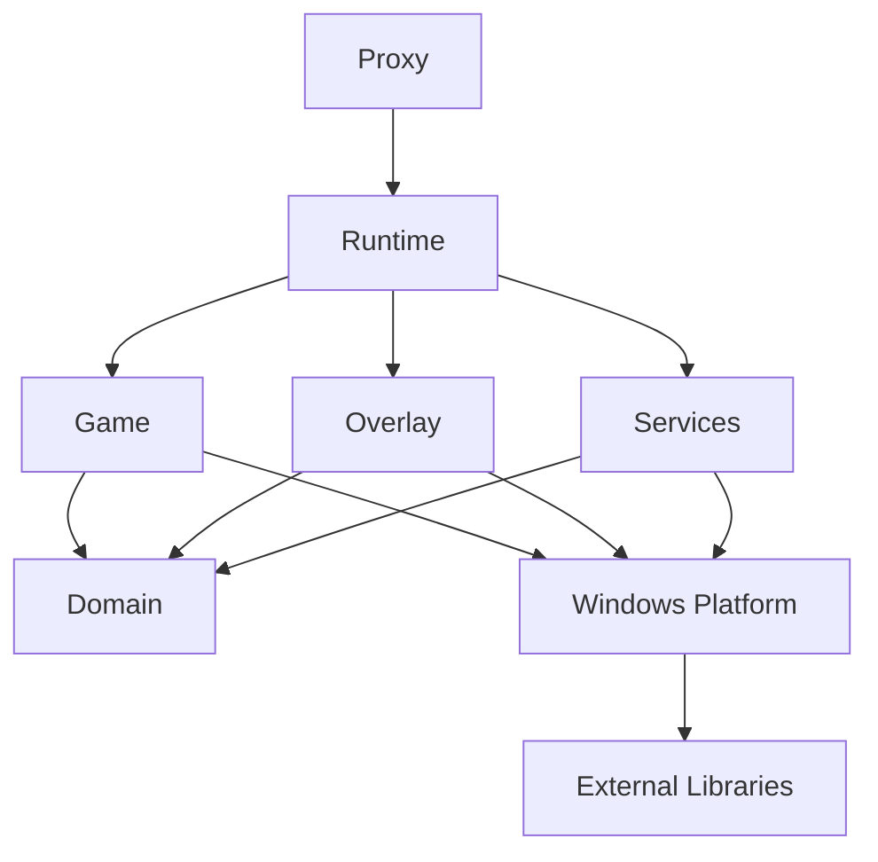
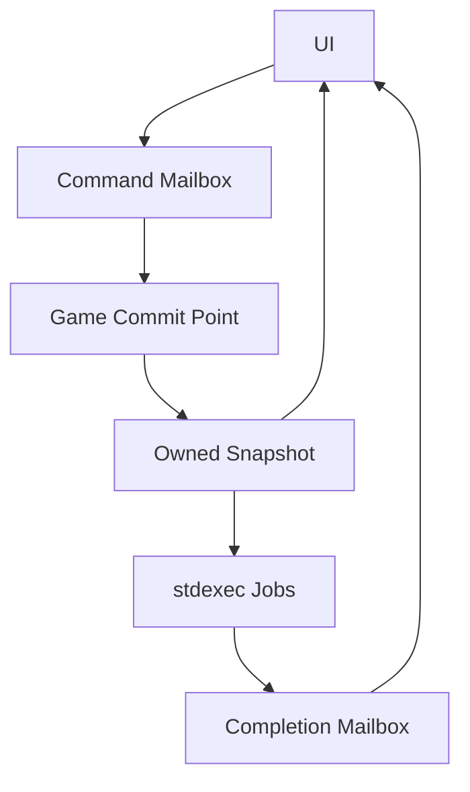
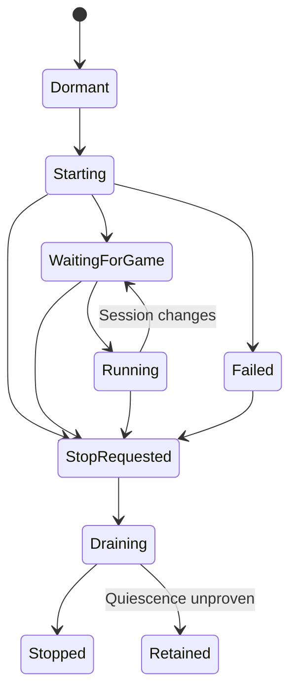

# S8RPKCheats 계층 분리와 C++23 런타임 재설계

작성 기준일: 2026년 10월 30일 한국 시간  
상태: 구현을 위한 세부 설계안  
대상: `29thnight/S8RPKCheats`의 DX11 기반 게임 내 도구와 프록시 DLL

## 1. 설계 목표와 결정

게임별 기능과 기존 사용자 설정을 보존하면서 NightFyre 유래 실행 골격을 자체 런타임으로 교체한다. 기본 설계는 값 타입, 명시적인 소유권, 자유 함수, 닫힌 상태 집합, 단방향 데이터 흐름으로 구성한다. C++/WinRT는 Windows 자원 관리와 적합한 Windows Runtime API의 기본 선택으로 사용한다. NVIDIA stdexec는 백그라운드 작업의 실행·완료·취소·수명을 구성하는 공통 계층으로 채택한다.

| 요구 | 확정 설계 방향 | 완료 판단 |
|---|---|---|
| 구성별 계층 분리 | 도메인, 게임 연결, Windows 플랫폼, 오버레이, 실행 서비스, 조립 계층 분리 | 도메인에 Windows·ImGui·MinHook 헤더가 없음 |
| 매크로 최소화 | 타입은 using, 상수는 constexpr, 동작은 함수·템플릿, 선택은 enum·variant·concepts | 자체 코드의 함수·변수·WinAPI 이름 재정의 매크로 0개 |
| stdexec 사용 | 설정·데이터 파싱, 검색·집계, 비동기 완료의 조합에 적용 | 소유된 작업 범위와 종료 계약이 있으며 무제한 작업 발행이 없음 |
| 최소 OOP | 구조체와 자유 함수, 합성, 국소적인 RAII | 기능 계층의 상속 트리·전역 서비스 조회·불필요한 virtual 인터페이스 없음 |
| ownership_cpp 사용 | 모듈의 동적 단독 소유, 비동기 스냅샷의 필요한 공유 소유 | 외부 게임 메모리와 COM 자원의 소유 체계가 섞이지 않음 |
| C++/WinRT 최대 적용 | com_ptr, handle, file_handle, hstring 및 적합한 Storage API | COM 수동 Release 제거, 핸들별 올바른 해제 규칙 유지 |
| reflgen 활용 | 설정과 기재 DTO의 선언형 메타데이터·직렬화 | 게임 메모리·런타임 객체를 반사하여 직렬화하지 않음 |
| MSVC C++23 | 안정판 14.51의 C++23 모드를 기준으로 고정, 14.52 RC 검증 구성 분리 | Debug·Release 모두 기능 검출과 동일 표준 계약 통과 |
| 최신 STL 활용 | 실제 데이터·수명·성능 요구에 맞춘 C++20/23 기능 적용 | 표준 기능을 사용하되 핫 패스 할당과 수명 오류가 증가하지 않음 |

이 문서의 새로운 타입·함수·디렉터리 이름은 구현할 계약이다. 외부 라이브러리 API와 별도로 표시한다. 예시 코드는 설계를 설명하며, 구현 단계에서 선택한 MSVC·SDK·라이브러리 조합으로 컴파일을 확인한다. 현재 성능 수치는 새 설계의 성능 증거로 사용하지 않는다.

## 2. 기준 소스와 현 상태

### 2.1 고정 기준

| 구성 | 비교 기준 |
|---|---|
| S8RPKCheats | `068ca1d881edf870f7cf06f935cf50e286004af8` |
| NightFyre 원본 | `b44d74cbb20918c1b616190325ee49589b80cf36` |
| NVIDIA stdexec | `314637d32d23a3b22ff4b45aa0b17d53a60be0c2` |
| ownership_cpp | `3574d238d8000fb21825e5391047da7337ac7529` |
| reflgen_cpp | `ad8f894d11f9d602f519c7aab9d7e75b3cfbd50d` |
| C++/WinRT API 조사 | `9bb8a57e46aea546b70b0af73e2b4137b8fed759` |

위 외부 커밋은 조사한 API를 식별한다. 제품의 Windows SDK·C++/WinRT 패키지와 라이브러리 버전은 통합 빌드 검증 후 의존성 잠금 파일에 확정한다. 개발 브랜치 HEAD와 출시 패키지가 같다고 가정하지 않는다.

### 2.2 현재 구조에서 보존할 동작

현재 프로젝트는 NightFyre 저장소를 외부 패키지로 가져오지 않고 기반 구현을 직접 빌드한다. 독립화 대상은 초기화·렌더링·입력·훅 관리의 계승 구현이다. 기재, 책략, 전투, 설정, 메뉴의 게임별 동작은 기능별로 이관한다. [현재 프로젝트 구성][s8-project] [원본 Engine][night-engine]

| 현재 접점 | 현재 확인한 문제 또는 제약 | 이관 계약 |
|---|---|---|
| Source.cpp와 Source_impl.inc | 함수명과 Sleep·FreeLibraryAndExitThread를 전처리로 치환 | 초기화 단계와 종료 단계를 명시적인 함수로 표현 |
| ClientBGThread와 주 루프 | 각각 30ms 폴링, 초기화 재시도는 별도 스레드 | 이벤트와 다음 마감 시각으로 깨우는 조정 루프로 통합 |
| Menu::Loops | UI 관련 모듈에서 게임 상태 갱신·메모리 변경 수행 | 도메인 계산, 게임 읽기·쓰기, UI 렌더를 분리 |
| RenderManager | 장치·창·ImGui·입력·이미지·훅 관리가 결합 | 책임과 실행 스레드별 상태 분리 |
| UnhookD3D | MH_ALL_HOOKS 사용 | 모듈별 훅 소유권과 종료 순서 분리 |
| Config.cpp | 기존 저장 후 필드별 재읽기·재쓰기 형태 | 완성한 설정 하나를 검증·직렬화하여 한 번 교체 |
| 기재 데이터 파서 | 줄 배치와 수동 문자열 검색에 의존 | JSON 문법 해석과 도메인 검증 분리 |
| p1·gameBase 등 | 새 게임·불러오기에서 수명과 주소가 변경 | GameEpoch와 안정된 ID로 무효화 관리 |

근거: [Source 시작·종료][s8-source-impl], [매크로 래퍼][s8-source], [메뉴와 갱신][s8-menu], [설정 구현][s8-config], [기재 파서][s8-traits]. 표는 확인한 핵심 경로의 목록이며, 전체 저장소의 모든 스레드·매크로를 조사했다는 의미는 아니다. 이관 첫 단계에서 실제 빌드 입력 전체에 대한 목록을 확정한다.

책략 UI 준비는 렌더 초기화보다 이르고 일반 설정 적용은 게임 데이터가 준비된 뒤다. 새 초기화 상태 기계도 이 두 시점을 구분한다. 기존 Engine에 섞인 한글 IME, DPI, 폰트, 테마, 범위 이미지 로딩은 새 오버레이로 옮긴다. [초기화 순서][s8-source-impl] [설정 적용][s8-menu] [오버레이 구현][s8-engine]

## 3. 계층과 의존 방향

### 3.1 구성 단위

초기에는 정적 라이브러리 또는 명확한 소스 그룹으로 나눈다. 계층마다 별도 DLL을 만들지 않는다. 최종 배포 프록시 DLL 하나에 필요한 구성만 링크하여 ABI와 CRT 소유권 경계를 줄인다.

| 구성 | 책임 | 허용 의존성 | 외부에 제공할 값 |
|---|---|---|---|
| domain | ID, 설정 DTO, 오류, 명령, 검증 규칙, 순수 기능 계산 | STL | FeatureCommand, GameSnapshot, ValidatedConfig |
| game | 게임 버전·주소 프로파일, 검증된 읽기·쓰기, 세션 전환, 게임별 훅 | domain, platform의 메모리·훅 경계 | 복사한 스냅샷, 명령 적용 결과 |
| platform/windows | C++/WinRT 자원, Win32 잔여 API, 파일 교체, 모듈·메모리·훅 설치 | STL, C++/WinRT, MinHook | 값형 RAII, Result, 비동기 파일 결과 |
| overlay | DX11·DXGI, ImGui 프레임, 폰트·리소스, 입력 이벤트 | domain, platform/windows, ImGui | UI 명령, 입력 캡처 정책 |
| services | 설정 저장, 검색, 집계, 로그, stdexec 작업 수명 | domain, platform/windows, ownership_cpp, stdexec, reflgen | 설정·검색·진단 결과 메시지 |
| runtime | 초기화·종료·세션 상태, 큐, 위 구성들의 연결 | 모든 하위 구성 | 상태 전이와 제한된 제어 API |
| proxy | hid/dinput8/dxgi export와 최소 진입점 | runtime의 bootstrap 경계 | 기존 프록시 ABI |

runtime이 조립 위치다. 하위 구성은 runtime 헤더나 전역 Runtime 인스턴스를 참조하지 않는다. game은 overlay를 호출하지 않고, overlay는 game의 주소와 패치 함수를 호출하지 않는다. services가 게임 값을 필요로 하면 소유된 GameSnapshot을 입력으로 받는다.



그림은 프로젝트 내부 의존 방향이다. ImGui·stdexec·ownership_cpp 등 구성별 직접 외부 의존은 위 표에서 정의한다. 외부 헤더는 사용 구성에만 노출한다.

### 3.2 제안 디렉터리

| 경로 | 주요 내용 |
|---|---|
| src/domain/ | ids, errors, config, trait model, commands, pure feature rules |
| src/game/ | session, address profiles, feature bindings, snapshot extraction, command commit |
| src/platform/windows/ | windows API adapter, C++/WinRT handles, file commit, hook installation |
| src/overlay/ | dx11 state, input routing, imgui host, texture resources |
| src/ui/ | 기존 기능별 메뉴와 편집 패널, domain DTO에만 접근 |
| src/services/ | config, async jobs, search, diagnostics, log writer |
| src/runtime/ | composition, lifecycle, mailbox, task scopes, startup state |
| src/proxy/ | 기존 프록시 export·진입점·def |
| schemas/ | 설정·기재 직렬화와 UI 메타데이터 |
| resources/ | 기존 PNG·폰트 참조·RC 입력 |
| third_party/ | 잠근 버전 정보와 원문 라이선스 |
| docs/design/ | 이 설계와 후속 결정 기록 |

공용 pch.h에 Windows, ImGui, stdexec, reflgen을 모두 포함하지 않는다. 선택적으로 Windows 구현 파일에만 PCH를 사용한다. 첫 이관은 정상적인 헤더·cpp 경계로 진행하고 C++ 모듈 전환은 빌드 재현성을 확인한 뒤 독립 단계로 수행한다.

## 4. Rust식 값 중심 설계와 ownership_cpp

### 4.1 기본 규칙

상태는 struct, 동작은 해당 네임스페이스의 자유 함수로 표현한다. 불변식과 자원 해제가 필요한 타입은 생성자·소멸자·이동 연산을 가진 RAII 값 타입을 사용한다. virtual 기반 Engine·Manager·Service 계층을 추가하지 않는다. 확장점은 compile-time concepts 또는 좁은 함수 포인터와 context로 표현하고, 실제 런타임 타입 소거가 필요한 곳만 std::move_only_function을 사용한다.

닫힌 명령 집합은 std::variant, 단순 상태는 enum class, 실패 가능한 결과는 std::expected로 표현한다. using은 별칭이며 서로 다른 ID를 새 타입으로 만들지 않으므로, 혼동하면 안 되는 ID는 작은 struct로 정의한다.

```cpp
namespace s8::domain {
struct GameEpoch { std::uint64_t value; };
struct OfficerId { std::uint32_t value; };
struct RequestId { std::uint64_t value; };

enum class ErrorCode {
    InvalidData, StaleEpoch, UnsupportedVersion,
    QueueFull, Cancelled, PlatformFailure
};

struct Error {
    ErrorCode code;
    std::uint32_t native_code{};
};

template<class T>
using Result = std::expected<T, Error>;

struct SetFeature { std::uint32_t feature_id; bool enabled; };
struct SetOfficerValue { OfficerId id; std::uint32_t field_id; std::int32_t value; };
using CommandPayload = std::variant<SetFeature, SetOfficerValue>;

struct FeatureCommand {
    RequestId request;
    GameEpoch epoch;
    CommandPayload payload;
};
}
```

위 command 종류는 설명용이다. 구현에서는 기존 기능별 유효한 명령을 명시적으로 정의하고 범용 주소 쓰기 명령을 UI 경계에 노출하지 않는다. 이름만 Rust식으로 바꾸는 작업보다 명령·오류·수명의 계약을 먼저 고정한다.

### 4.2 소유권 선택표

| 대상 | 기본 표현 | 수명·동시성 계약 |
|---|---|---|
| 작은 설정·ID·오류·명령 | 값, array, optional, variant | 복사 또는 이동으로 전달 |
| Runtime이 독점하는 동적 상태 | own::unique_owner<T> | 한 소유자, 이동으로 이전 |
| 호출 중 잠깐 읽는 own 객체 | own::borrowed<const T> 또는 const T& | 호출자가 소유자를 계속 보관 |
| 여러 독립 작업이 함께 읽는 snapshot | own::shared_owner<const T> | 게시 후 불변, 작업마다 수명 보유 |
| 나중에 존재 여부를 확인하는 own 객체 | own::weak_owner<T> | lock 성공 후 보유 기간 안에서 사용 |
| 게임이 소유한 메모리 | GameRef와 ID·epoch | 해제하지 않음, 사용 직전에 게임 문맥에서 재검증 |
| COM·DXGI·D3D 인터페이스 | winrt::com_ptr<T> | COM AddRef/Release 규칙 |
| WinRT projected 객체 | StorageFile 등 projected 값 타입 | WinRT가 제공하는 참조 관리 |
| Win32 kernel/file handle | winrt::handle / winrt::file_handle | 정확한 invalid sentinel과 CloseHandle |
| 범위·문자열 view | span, string_view, mdspan | 원본 storage의 수명을 별도로 보장 |

ownership_cpp의 borrowed는 한 포인터 크기의 비소유 view이며 만료 검사나 borrow checker가 아니다. unique_owner는 임의 raw 포인터 adoption, 사용자 deleter, unique에서 shared로의 승격을 제공하지 않는다. 필요 시 처음부터 make_shared로 생성한다. local_owner는 스레드 간 작업 전달에 사용하지 않는다. [ownership_cpp 실제 계약][ownership-readme]

```cpp
#include <own/ownership.hpp>
#include <cstdint>

struct RuntimeState {
    std::uint64_t generation{};
};

void inspect_state(own::borrowed<const RuntimeState> state);

void demonstrate_borrow() {
    auto state = own::make_unique<RuntimeState>();
    inspect_state(state.borrow());
    // state는 호출과 그 안의 모든 접근보다 오래 살아 있어야 한다.
}
```

배열과 STL 컨테이너는 기존 값 의미를 사용한다. 불필요하게 모든 struct를 heap에 만들거나 모든 파라미터를 own 타입으로 바꾸지 않는다. COM 객체를 own::shared_owner<winrt::com_ptr<T>>로 중복 참조 계수화하지 않는다. 단, 여러 데이터를 묶은 실제 모듈 상태 자체를 own으로 소유하는 것은 가능하다.

### 4.3 게임 참조는 별도 계약

GameRef는 소유권이 아니라 게임 ID·주소 후보·세대·검증 프로파일을 나타낸다. 작업 스레드로 raw 게임 포인터를 넘기지 않는다. game 계층이 검증된 실행 문맥에서 필요한 필드만 내부 snapshot으로 복사한다. 이 snapshot만 작업으로 전달한다.

GameEpoch 일치와 VirtualQuery 성공은 동시 접근 안전성을 증명하지 않는다. 게임 객체의 변경·파괴와 충돌하지 않는 hook 시점, 실제 실행 스레드, 읽기·쓰기 범위를 기능별로 확인해야 한다. 이 근거를 확보하지 못한 기능은 새 비동기 경로에서 활성화하지 않고, 명시적인 기존 호환 경로로 남긴 뒤 별도 이관한다.

## 5. C++/WinRT 적용 범위

### 5.1 기본 선택

Windows 구현 계층에서는 C++/WinRT의 소유권·문자열·비동기 API를 우선 사용한다. WinRT projection이 없는 후킹·메모리 보호·창 프로시저·DXGI 조작은 Win32/DXGI API를 호출하되 C++/WinRT의 적합한 RAII 타입으로 자원을 보관한다. 이 정책은 WinUI로 UI를 재작성하거나 프로세스의 창 모델을 변경한다는 의미가 아니다.

| 자원·작업 | 적용 타입 또는 API | 남는 네이티브 경계 |
|---|---|---|
| ID3D11Device, Context, Texture2D, RTV, SRV | winrt::com_ptr<T> | Direct3D 11 함수 호출 |
| IDXGISwapChain | winrt::com_ptr<IDXGISwapChain> | Present·ResizeBuffers·후킹 |
| event·thread 등 CloseHandle 자원 | winrt::handle | 생성·대기·종료 API |
| CreateFileW의 파일 핸들 | winrt::file_handle | 특수 파일 열기·flush·교체 |
| WinRT 문자열 경계 | winrt::hstring, to_string, to_hstring | core 내부 UTF-8 값과 명시적으로 변환 |
| 파일 가져오기와 비동기 읽기 | StorageFile, FileIO, IAsyncOperation | unpackaged host 검증을 통과한 경로에 적용 |
| HWND | 비소유 WindowRef | 게임 창은 DestroyWindow하지 않음 |
| HDC·HIMC | 해당 acquire/release를 짝지은 작은 RAII 값 | ReleaseDC·ImmReleaseContext에는 원래 HWND도 필요 |
| HMODULE | 비소유 ModuleRef 또는 정확한 handle_type traits | 자신이 얻은 LoadLibrary 참조에만 FreeLibrary |
| VirtualQuery·VirtualProtect·FlushInstructionCache | platform의 좁은 함수 | 동일 기능의 WinRT projection 없음 |

winrt::handle은 null, file_handle은 INVALID_HANDLE_VALUE를 invalid 값으로 사용하며 둘 다 CloseHandle 계열 소유권이다. HWND·HDC·HIMC·HMODULE에 일괄 적용하지 않는다. 적절한 단일 값 해제 규칙이면 winrt::handle_type<Traits>, 여러 값이나 스레드 문맥이 필요한 해제면 작은 RAII struct를 사용한다. [C++/WinRT 자원 전환][winrt-migration] [C++/WinRT handle 구현][winrt-handles]

### 5.2 COM 참조 규칙

Present로 전달된 pSwapChain은 callback의 빌린 인자다. callback 밖에서도 보관하려면 copy_from으로 AddRef한다. 소유 참조를 반환하는 out parameter에는 빈 com_ptr의 put 또는 put_void를 제공하고, 이미 받은 owned raw reference를 넘겨받을 때 attach를 사용한다. 소유권을 받지 않은 포인터를 attach하면 게임의 참조를 잘못 해제할 수 있다.

```cpp
#include <winrt/base.h>
#include <d3d11.h>
#include <dxgi.h>

struct Dx11State {
    winrt::com_ptr<IDXGISwapChain> swap_chain;
    winrt::com_ptr<ID3D11Device> device;
    winrt::com_ptr<ID3D11DeviceContext> context;
    winrt::com_ptr<ID3D11RenderTargetView> target;
};

// callback 인자를 보관할 때 사용하는 실제 C++/WinRT API 예시.
void retain_swap_chain(Dx11State& state, IDXGISwapChain* borrowed) {
    state.swap_chain.copy_from(borrowed);
}
```

위 예시는 copy_from의 소유권 의미만 설명한다. 운영 코드에서는 swap chain만 바꾸고 이전 device·context·RTV를 남기지 않는다. 초기화는 임시 Dx11State에 모든 필수 자원을 확보한 뒤 활성 상태로 이동한다. 각 HRESULT를 검사하고 실패 시 기존 활성 상태를 부분적으로 바꾸지 않는다. 새 COM out parameter는 빈 로컬 com_ptr로 받은 후 성공 시 move-commit하여 SDK 버전별 put 동작 차이에 덜 의존한다. [com_ptr 계약][winrt-com-ptr]

com_ptr는 수명을 관리하며 객체를 thread-safe 또는 agile하게 바꾸지 않는다. immediate context·RTV·ImGui 사용은 실제 Present 실행 문맥에 묶는다. 참조 계수 감소와 객체 사용 종료의 순서는 별도의 종료 계약으로 보장한다.

### 5.3 아파트먼트와 예외 경계

게임이 소유한 Present·WndProc·hook 스레드에서 init_apartment를 호출하거나 기존 COM apartment를 바꾸지 않는다. WinRT activation을 담당하는 자체 coordinator 스레드는 WinRT 기능을 활성화하기 전에 필요한 MTA를 초기화하고 동일 스레드 종료 시 해제한다. CPU pool 작업은 기본적으로 순수 데이터 처리만 한다. 이후 COM 작업이 필요해지면 해당 실행 문맥의 초기화와 마샬링 계약을 먼저 추가한다.

비동기 코루틴은 다른 스레드에서 재개될 수 있으므로 init_apartment/uninit_apartment를 코루틴의 일반 로컬 guard 하나에 맡기지 않는다. thread lifetime과 coroutine lifetime을 구분한다. WinRT completion callback은 기본적으로 DTO·소유한 byte buffer를 제한된 mailbox에 전달하며 ImGui나 게임 메모리에 직접 접근하지 않는다. projected 객체 자체를 넘길 때는 agility 또는 명시적인 marshaling을 확인한다. strong reference가 cross-apartment 접근 허용을 뜻하지 않는다.

C++/WinRT projected API의 hresult_error는 platform 경계에서 도메인 Error로 변환한다. 실패를 expected로 표현하더라도 /EHsc는 유지한다. C·WinAPI·COM hook 경계를 C++ 예외가 통과하지 않도록 callback 최외곽에서 처리한다. Access violation을 일반 C++ 예외로 간주하거나 SEH로 반복 은폐하지 않는다.

### 5.4 WinRT 비동기 작업과 stdexec 연결

애플리케이션의 작업 조합과 취소는 stdexec로 통일한다. WinRT IAsyncOperation은 플랫폼 비동기 제공자로 사용한다. runtime::from_winrt_async라는 좁은 adapter를 구현 대상으로 둔다. 이 이름은 stdexec나 C++/WinRT의 기존 API가 아니다.

adapter는 이미 시작된 operation보다 operation factory를 입력으로 받는다. admission과 operation state 소유권을 확정한 뒤 sender 시작 시 factory를 실행한다. 완료 상태를 값·오류·취소로 정확히 한 번 전달하고, 작업 객체와 completion handler를 완료 확인까지 보유한다. stop 요청은 IAsyncInfo::Cancel로 전달하되 Cancel 반환을 완료로 간주하지 않는다. 완료가 stop 등록보다 먼저 일어나는 경우와 동시에 일어나는 경우를 포함한다. GetResults의 HRESULT 예외는 Error로 변환한다. handler 내부에서 scope join, 파일 추가 읽기, UI 갱신을 수행하지 않는다.

수락한 작업은 terminal slot을 미리 예약한다. completion은 이 자리에 기록하고 wakeup만 게시하며 queue full로 버리지 않는다. receiver 완료가 operation state를 즉시 파괴할 수 있으므로 set_value·set_error·set_stopped 이후 그 state에 접근하지 않는다. 완료 신호와 handler의 실제 반환은 별개이며, callback stack이 실행 중인 동안 DLL 수명을 유지한다.

resume_background를 일반 작업 발행 API로 병용하지 않는다. WinRT 자체가 사용하는 OS 작업 스레드까지 없앨 수는 없으므로, 제어 가능한 추가 실행 경로와 스레드 수를 따로 기록한다. 파일 commit에 필요한 FlushFileBuffers·ReplaceFileW의 계약은 네이티브 adapter로 유지한다.

## 6. 실행 문맥과 stdexec

### 6.1 실행 문맥을 먼저 구분한다

| 실행 문맥 | 담당 작업 | 금지 또는 제한 |
|---|---|---|
| loader lock 안의 DllMain | 최소 상태 보관과 종료 신호 | pool·WinRT activation·COM 초기화·join·중요 파일 처리 없음 |
| 검증된 게임 callback | 게임 snapshot 추출, 명령 적용, 기능별 동기 계산 | blocking I/O·sync_wait·범용 background spawn 없음 |
| Present 소유 문맥 | ImGui 프레임, DX11 자원, UI 결과 소비 | 게임 메모리 직접 변경·파일 파싱 없음 |
| WndProc 소유 문맥 | 원래 메시지 전달, 입력 이벤트 수집 | ImGui를 다른 스레드에서 동시 호출하지 않음 |
| 자체 coordinator 1개 | deadline·mailbox·설정 적용 순서·WinRT activation·종료 조정 | 게임 메모리 읽기·쓰기와 장시간 CPU 작업 없음 |
| stdexec CPU pool | 복사된 데이터의 파싱·검증·검색·집계·직렬화 준비 | 게임 포인터·ImGui·D3D context 접근 없음 |
| WinRT completion 문맥 | 완료 결과의 게시 | 완료 이후 수명 없는 참조 보관 없음 |

이 표는 자체 추가 스레드의 설계다. 게임·드라이버·WinRT 내부가 사용하는 OS 스레드 수를 제한한다는 뜻은 아니다. 기존 기능별 별도 스레드는 이관 목록으로 관리하고 최종적으로 coordinator 또는 소유된 task scope에 편입한다.

### 6.2 stdexec 채택 범위

stdexec는 C++26 sender/receiver 모델의 외부 구현이며 C++20 이상에서 사용 가능하다. C++23 STL의 std::execution::par와 다른 API다. include는 stdexec/execution.hpp와 선택한 exec 확장 헤더를 사용하고 std 네임스페이스로 별칭을 주입하지 않는다. [stdexec 기준 README][stdexec-readme]

| 작업 | stdexec 적용 | 이유 |
|---|---|---|
| JSON decode·설정 검증 | 적용 | 입력 소유권이 명확하고 UI·게임 문맥과 분리 가능 |
| immutable snapshot 검색·정렬·집계 | 적용 | 세대가 붙은 입력과 결과로 취소·폐기를 처리 가능 |
| 설정 파일 직렬화 준비 | 적용 | 저장 묶음 구성과 오류 전달이 명확함 |
| WinRT async 완료 후 파싱 | adapter로 적용 | OS 비동기 I/O와 CPU 실행 문맥을 연결 |
| Present와 WndProc | 직접 적용하지 않음 | 동기 반환·원래 스레드·플랫폼 callback 계약 |
| 게임 메모리 쓰기 | pool에 제출하지 않음 | executor의 직렬화가 게임 객체와의 동기화를 보장하지 않음 |
| 254개 기재의 간단한 계산 | 우선 단일 작업 | 작은 작업의 분할·할당·게시 비용이 이득보다 클 수 있음 |
| 단순 로그 한 건·bool 토글 | 개별 spawn하지 않음 | 고빈도 작은 작업의 관리 비용을 줄임 |
| UI 대기·타이머 | coordinator deadline 활용 | 별도 timed context 스레드와 중복하지 않음 |

### 6.3 풀 선택과 작업 수명

초기 선택은 exec::static_thread_pool에 worker 수 1을 명시하는 것이다. 1 worker는 동시 작업 분산보다 게임·렌더 스레드에서 작업을 분리하는 목적이다. worker 2개는 실제 CPU 작업이 충분하고 게임 프레임의 p95·p99가 나빠지지 않을 때 허용한다. 기본 생성자의 hardware_concurrency 기반 풀과 전역 system scheduler는 사용하지 않는다.

exec::windows_thread_pool도 upstream에 존재하며 후속 비교 대상으로 둔다. Windows pool로 전환할 때는 최소·최대 worker, OS 콜백 수명, deadline와 WinRT의 실제 완료 동작을 함께 측정한다. stdexec가 Windows를 지원하지 않아 static pool을 선택하는 것이 아니다. 현재 선택 이유는 명시적인 worker 수와 종료 소유권이다. [stdexec 실행 모델][stdexec-pool]

최신 고정 소스의 stdexec::counting_scope를 사용한다. get_token·close·request_stop·join 계약은 실제 헤더 기준으로 고정한다. legacy exec::async_scope의 spawn·on_empty와 혼합하지 않는다. pool을 scope보다 먼저 생성하고 scope보다 나중에 파괴하는 member 선언 순서를 유지한다. 이동 불가능한 scope를 포함하는 활성 task 상태는 안정된 주소에 만들고 이동시키지 않는다. [scope API][stdexec-scope]

종료 순서는 다음과 같다.

1. 애플리케이션 admission gate를 닫고 producer와 발행 중인 작업의 경합을 정리한다.
2. task scope의 새 작업 수락을 닫는다.
3. stop을 요청하고 WinRT 작업에 cancellation을 전달한다.
4. scheduler와 완료 mailbox를 계속 작동시켜 작업을 완료 상태로 만든다.
5. scope join 완료를 확인한 뒤 operation state와 입력 storage를 해제한다.
6. 마지막에 pool을 파괴한다.

scope를 join하기 전에 worker를 없애지 않는다. pool worker 안에서 같은 pool의 작업을 sync_wait하지 않는다. 살아 있는 coordinator가 종료를 시작할 때는 완료 처리에 coordinator 실행이 필요한 동안 event loop를 멈추지 않는다. sync_wait는 모든 continuation이 독립적으로 진행 가능하다는 것이 확인된 최종 경계에만 둔다.

### 6.4 취소와 발행 비용

stop은 협력적 요청이다. 이미 실행 중인 임의 함수나 동기 파일 호출을 강제 중단하지 않는다. 검색·집계는 청크 경계에서 stop과 epoch를 확인하고, 파일 저장은 commit 전 취소 가능 구간과 교체를 끝내야 하는 구간을 구분한다.

spawn은 작업 상태의 heap allocation을 수반할 수 있으며 조사한 구현도 할당 경로를 가진다. 프레임마다 수백 개의 spawn을 만들지 않는다. 기능별 작업을 묶고 검색은 이전 요청을 대체하며 저장은 dirty generation을 합친다. hot path에는 bounded command·log queue를 사용한다.

stdexec가 task graph를 구성한다고 모든 연산이 병렬화되지는 않는다. bulk도 pinned API의 실행 정책과 데이터 분할을 확인한 뒤 큰 순수 계산에만 사용한다. 조사한 버전의 형태는 stdexec::bulk(stdexec::par, count, function)이다. 매개변수·completion signature를 라이브러리 버전 업그레이드 때 컴파일로 검증한다.

### 6.5 실제 API의 최소 구성 예시

다음은 API 연결을 설명하는 독립 예시다. 외부 producer가 없으며, production의 admission·terminal slot·generation 처리는 별도다. 호출 위치는 loader lock 밖이다.

```cpp
#include <atomic>
#include <utility>
#include <exec/static_thread_pool.hpp>
#include <stdexec/execution.hpp>

void demonstrate_task_lifetime() {
    std::atomic<unsigned> completed{0};
    std::atomic<bool> failed{false};
    exec::static_thread_pool pool{1};
    stdexec::counting_scope scope;

    auto work = stdexec::starts_on(
        pool.get_scheduler(),
        stdexec::read_env(stdexec::get_stop_token)
            | stdexec::then([&completed](auto stop) noexcept {
                  if (!stop.stop_requested()) {
                      completed.fetch_add(1, std::memory_order_relaxed);
                  }
              }))
        | stdexec::upon_error([&failed](auto&&) noexcept {
              failed.store(true, std::memory_order_relaxed);
          });

    stdexec::spawn(std::move(work), scope.get_token());
    scope.close();
    scope.request_stop();
    (void)stdexec::sync_wait(scope.join());
}
```

도메인 실패는 Result 값으로 전달할 수 있다. 다만 Result를 반환하는 것만으로 sender 전체의 set_error 채널이 제거되지는 않으므로 scheduler·구성 요소·예외에서 생길 수 있는 나머지 오류도 처리한 뒤 spawn에 전달한다. spawn 자체의 allocation failure는 별도의 coordinator 경계에서 처리하고 예약한 작업 슬롯을 반환한다. scope가 이미 닫혀 수락되지 않은 경우에도 입력 storage와 슬롯을 반환한다. 위 예시는 즉시 stop하므로 completed 증가를 보장하는 예제가 아니다.

## 7. 데이터 전달과 동시성

### 7.1 메시지 흐름



게임 변경은 UI의 요청 값으로 표현한다. game 계층이 실제 주소를 재해석하고 epoch·버전·유효 범위를 확인한 뒤 적용한다. UI가 표시한 snapshot의 포인터나 offset을 나중에 그대로 쓰지 않는다.

### 7.2 게시 규칙

공유 snapshot은 게시 후 불변이다. 초기 구현은 짧은 mutex 구간에서 shared_owner를 복사하고 잠금을 즉시 풀어 사용한다. 독자가 한 프레임 동안 보유할 snapshot을 한 번만 취득한다. own 포인터에 std::atomic<shared_ptr> 전문화가 있다고 가정하지 않는다. 동일 shared_owner 변수의 동시 reset·copy도 별도 동기화가 필요하다.

Present는 게시 mutex가 경합하면 마지막으로 보유한 snapshot을 계속 표시하는 try-lock 정책을 사용할 수 있다. 해제 비용이 큰 snapshot의 마지막 참조가 Present에서 사라지지 않도록 worker 또는 coordinator에서 회수할 수 있는 보관 정책을 둔다. reader acknowledgement·frame/job epoch·scope 완료 등으로 사용 종료를 확인하며 단순 참조 수 조회만으로 회수 시점을 판단하지 않는다. 보관 상한에 도달하면 snapshot 생산을 합치거나 늦춘다.

SPSC queue는 실제 producer가 하나일 때만 사용한다. UI·WinRT completion·다수 게임 hook이 동시에 쓰는 mailbox는 MPSC이므로 SPSC 구현을 재사용하지 않는다. 초기의 짧은 mutex+고정 용량 queue를 먼저 사용하고 측정으로 필요한 경로만 개선한다. 게임 hook에서 잠금 대기를 허용하지 않는 이벤트는 별도 원자적 최신 값 또는 drop 허용 진단 채널로 분리한다.

admission·queue·상태 mutex는 값을 이동하거나 상태를 갱신하는 동안만 잡는다. 잠금을 푼 뒤 spawn·request_stop·Cancel·외부 callback·잠재적으로 마지막 참조를 해제하는 작업을 수행한다. 이 호출들이 동기적으로 재진입할 수 있기 때문이다. admission은 gate 검사와 슬롯 예약이 하나의 수락 결정이 되게 하고, close와 경합해 거절된 요청의 소유권을 반환한다.

### 7.3 초기 용량과 초과 정책

다음 수치는 구현 시작을 위한 설정값이며 측정 결과가 아니다. 실제 최대 부하로 조정한다.

| 항목 | 초기 제안 | 초과 또는 지연 처리 |
|---|---|---|
| 전체 in-flight 요청 | WinRT와 CPU 단계가 속한 논리 요청 합계 8개 | 작업 단계가 중첩되면 같은 요청 슬롯에 추적, 별도 병렬 operation은 추가 reservation |
| terminal result | 수락한 operation마다 미리 예약 | 완료·오류·취소를 정확히 한 번 기록, wakeup queue 포화로 유실하지 않음 |
| UI command queue | 256개 | 중요한 명령은 QueueFull로 실패 표시, 조용히 유실하지 않음 |
| 동일 기능의 연속 값 변경 | feature ID별 마지막 값 합치기 | 이력 자체가 의미 있는 명령은 합치지 않음 |
| 설정 저장 | 실행 중 1개와 최신 대기 generation 1개 | 중간 generation 통합 |
| 검색 | 입력 유형별 1개 활성 요청 | 이전 요청 stop, request ID로 오래된 완료 폐기 |
| snapshot 게시 | 최신 snapshot과 제한된 이전 세대 | 독자 종료 후 회수, 무제한 retired 목록 금지 |
| 진단 로그 | 고정 레코드 ring | 저우선순위 drop 수 집계, 오류 로그용 별도 여유 |
| 한 번의 game commit | 개수와 시간 예산 모두 적용 | 남은 명령은 다음 검증된 commit 시점으로 이월 |

게임의 필수 동기 hook 결과는 queue 지연으로 바꾸지 않는다. 해당 callback 안에서 끝나야 하는 계산은 제한된 순수 함수로 유지한다. 모든 accepted operation의 terminal acknowledgement와 callback 수명 정리가 끝난 뒤 completion storage를 닫는다. 완료 callback은 coordinator가 빈자리를 만들기를 기다리지 않는다.

## 8. 초기화와 종료 상태 기계

### 8.1 런타임 상태



coordinator가 상태 전이를 소유하고 다른 실행 문맥은 요청만 게시한다. 초기화 중 stop은 완료된 단계만 역순 정리하며 반복 stop은 같은 종료 절차에 합류한다. GameEpoch의 변경은 런타임 전체를 재생성하는 것과 다르다. 새 게임·불러오기·전투 종료에서 game-bound cache와 대기 명령만 무효화하고, 설정 서비스와 오버레이는 유효한 수명을 유지한다.

### 8.2 시작 순서

DllMain은 최소 상태만 다룬다. 실제 bootstrap은 loader lock 밖에서 실행한다. 프록시의 최초 export가 항상 안전한 초기화 지점이라고 가정하지 않는다. 기존 진입 방식에 bootstrap thread 생성이 필요하면 동기 대기를 하지 않는 작은 경계로 남기고, COM·WinRT·stdexec·파일 설정 초기화는 thread entry 이후로 지연한다. CreateThread를 DllMain에서 호출하는 방식 자체도 별도 플랫폼 검토 항목이다. [Microsoft DLL 지침][dll-best]

실제 시작은 다음 순서를 따른다.

1. loader가 보유한 참조가 유효한 bootstrap 구간에서 단일 시작을 확보하고 자체 module reference를 보유한다. 이 thread가 coordinator 역할을 이어받는다.
2. 초기 설정의 필요한 최소 항목을 크기가 제한된 native 읽기와 공통 JSON 계약으로 검증한다. early bridge의 시점을 지키기 위한 좁은 예외이며 파일 자원은 winrt::file_handle로 관리한다.
3. MinHook 사용 수명과 수동 patch·code cave까지 포함하는 소유권 registry를 먼저 준비한다.
4. 책략 UI의 초기 준비·설치를 수행한다. 준비 완료·실패·기능 꺼짐을 명시적으로 구분한다.
5. 작업 pool을 생성하고 그 뒤 scope를 생성한다. coordinator의 WinRT 기능을 활성화하기 전에 MTA 초기화를 완료한다. 일반 파일 읽기부터 검증된 WinRT adapter를 사용한다.
6. DX11 hook과 입력 경계를 연결하고 실제 장치에서 overlay를 초기화한다.
7. 게임 준비 상태를 확인한다. 재시도는 별도 스레드 대신 deadline으로 예약한다.
8. GameEpoch를 확정한 뒤 검증된 설정과 기능을 게임 commit 문맥에서 적용한다.

각 단계의 실패는 해당 단계가 획득한 자원만 역순으로 정리한다. 무조건 MH_ALL_HOOKS를 제거하는 전역 rollback을 쓰지 않는다.

### 8.3 종료와 실제 언로드

기능 비활성화, 런타임 정지, DLL 실제 언로드를 별도 작업으로 둔다. 정상 정지에서는 새 요청을 막고 background 작업을 정리하며, 렌더·입력·게임 callback이 사용할 상태의 수명을 확인한다. COM·ImGui·창 관련 정리는 원래 소유 문맥에서 수행하고 coordinator는 완료 확인을 받는다.

in-flight callback 카운터만 0이라고 DLL 언로드가 안전해지는 것은 아니다. callback 진입과 훅 비활성화의 경합, 원래 trampoline 실행, WndProc 전달 체인, 게임에 넘긴 문자열 주소, 외부 callback 등록을 함께 닫아야 한다. MinHook의 작업 완료를 모든 게임 스레드의 quiescence 증거로 간주하지 않는다.

실제 언로드는 모든 실행 진입점·작업·외부 참조의 종료를 증명한 경우에만 제공한다. 증명이 안 되면 기능을 정지하고 필요한 코드·trampoline·참조 상태를 프로세스 종료까지 보관하는 Retained 상태로 남긴다. unsafe free로 종료 시간을 맞추지 않는다. 프로세스 종료 중 DllMain에서는 join·WinRT async 대기·복잡한 COM 파괴를 수행하지 않는다.

Retained는 상태 플래그만 남기는 방식이 아니다. bootstrap에서 reference를 증가시켜 보유한 self-module 참조를 종료 증거가 확보될 때까지 유지한다. borrowed GetModuleHandle 결과와 구분하고, 무조건적인 영구 PIN과도 구분한다. 자기 DLL의 마지막 참조는 일반 RAII destructor에서 FreeLibrary로 해제하지 않는다. 모든 로컬 자원 정리 후 FreeLibraryAndExitThread 같은 전용 최종 경계에서 해제한다. [module reference 계약][module-ref]

게임이 문자열 포인터를 장기 보관하는 기능은 데이터 세대의 회수 조건을 별도로 정의한다. 구 세대의 참조가 사라졌다는 근거 없이 문자열 버퍼를 free하거나, 근거 없이 무한히 축적하는 두 방식 모두 최종 설계로 인정하지 않는다.

## 9. 매크로 제거 정책

### 9.1 대체 우선순위

| 목적 | 우선 선택 | 매크로 허용 여부 |
|---|---|---|
| 타입·함수 포인터·템플릿 별칭 | using | 불필요 |
| 상수·버전·offset | constexpr, 강한 값 타입 | RC 등 C++를 해석하지 못하는 입력만 예외 |
| 공통 연산 | 함수·람다·템플릿 | 불필요 |
| 컴파일 시 분기 | concepts, requires, if constexpr | 존재하지 않는 SDK 선언을 파싱에서 제외해야 할 때만 전처리 |
| 런타임 기능 선택 | enum class·variant·설정 값 | 불필요 |
| 진단 위치 | source_location | __FILE__·__LINE__ 전달용 자체 매크로 불필요 |
| 스키마·등록 목록 | constexpr descriptor·reflgen | X-macro 불필요 |
| DLL export | extern "C"와 .def | target별 import/export가 정말 필요한 공개 ABI만 예외 |
| SDK 설정·기능 검출 | 중앙 build 설정·toolchain contract | SDK 전처리 계약 때문에 허용 |
| RC 자원 식별자 | 생성한 RC 전용 define | resource compiler 제약으로 허용 |

using으로 함수의 텍스트 치환을 재현하지 않는다. 함수 이름을 바꾸거나 동작을 삽입해야 하면 실제 함수 분리와 직접 호출로 표현한다.

### 9.2 현재 코드의 구체적인 이관

| 현재 치환 | 대체 설계 |
|---|---|
| LoadEarlyLogConfig·InitCheats 등의 define | bootstrap 단계 함수와 결과 값 |
| Sleep을 T01StartupSleep으로 치환 | wait_for_game_ready와 deadline 조건을 명시 |
| FreeLibraryAndExitThread 치환 | request_stop·drain·final_release 단계 |
| SaveConfig·LoadConfig 치환 | decode·validate·apply·encode·commit 함수 |
| DrawMarqueeNotifications에 maintenance 삽입 | maintenance 실행과 draw_notifications를 독립 호출 |
| MonitorBattleStatus 치환 | 명시적 game poll과 선택적 진단 guard |
| VirtualQuery 치환 | query_memory_region과 negative cache 정책 분리 |
| TRAITS_PTR_OFFSET | 버전별 ModuleOffset 값 |
| SAM8_CHEAT_VERSION | 생성한 build_info constexpr 문자열 |

근거: [Source 매크로][s8-source], [Menu 매크로][s8-menu-wrapper], [Config 래퍼][s8-config], [OfficerData 경계][s8-officer-data].

기능을 치환하기 위해 implementation 본문을 include하는 .inc 경로는 정상적인 cpp로 이관한다. #pragma once와 include는 매크로 함수와 구분한다. 외부 ImGui·MinHook·stdexec·C++/WinRT 내부 매크로는 원본을 유지한다. 자체 wrapper 매크로를 추가하여 외부 복잡성을 전체 코드로 퍼뜨리지 않는다.

예외 매크로에는 위치, 이유, 일반 C++로 해결할 수 없는 이유를 짧게 기록한다. NOMINMAX·WIN32_LEAN_AND_MEAN·플랫폼 버전·표준 기능 검출은 중앙화하고, WINAPI·APIENTRY 등 SDK ABI 표기는 platform 경계에서 사용한다.

## 10. MSVC C++23 기준과 빌드 계약

### 10.1 현재 사용할 기준

2026년 10월 30일 기준 MSVC 14.51은 production 계열이고 14.52는 RC다. 14.52 RC는 /std:c++23을 도입했으며 /std:c++23preview는 이 모드의 deprecated alias다. 14.52 안정판 출시는 11월 예정으로 발표되어 있다. 현재 stable과 RC를 동일하게 취급하지 않는다. [14.52 RC 발표][msvc-1452] [14.51 C++23][msvc-1451] [STL 변경 기록][stl-changelog]

| 구성 | 선택 | 용도 |
|---|---|---|
| 기본 제품 구성 | MSVC 14.51, /std:c++23preview | 현재 안정판에서 C++23 기능 계약 적용 |
| 선행 호환 검증 | MSVC 14.52 RC, /std:c++23 | 정식 표기와 신규 compiler 동작 검증 |
| 후속 정식 기준 | 14.52 GA 출시와 통합 검증 후 /std:c++23 | 검증 완료 시 기본 구성 승격 |

C++20 fallback과 /std:c++latest의 자동 채택은 두지 않는다. /std:c++latest는 후속 표준 기능이 섞일 수 있어 C++23 계약을 고정하지 못한다. 14.52의 constexpr cmath는 /Zc:cmath opt-in이며 현재 설계는 이 기능에 의존하지 않는다. 기존 v145 표기만으로 compiler minor 버전을 고정하지 않는다.

### 10.2 구성별 공통 설정

| 설정 | 정책 |
|---|---|
| 대상 | Windows x64 프록시 DLL, 기존 지원 게임 버전 계약 유지 |
| 언어 표준 | Debug·Release·진단 구성 모두 동일한 C++23 |
| conformance | /permissive- /Zc:__cplusplus /Zc:preprocessor |
| 인코딩 | /utf-8, 정상 char8_t 사용. 자체 코드의 /Zc:char8_t- 제거 |
| 예외 | /EHsc 유지. 도메인은 expected, 외부 예외는 경계에서 변환 |
| 경고 | 자체 코드 /W4, 외부 헤더의 경고는 별도 정책 |
| stdexec 설정 | pinned upstream의 /Zc:externConstexpr /bigobj 등 필수 옵션을 사용하는 target에 반영 |
| C++/WinRT | Microsoft.Windows.CppWinRT 3.0.260818.1을 통합 후보로 고정, projection 공급 경로 하나 선택 |
| coroutine | C++23 표준 coroutine 사용, /await와 /ZW 사용하지 않음 |
| CRT·allocator | 모듈 내부에서 생성·파괴, 게임 ABI에 STL·own 객체를 노출하지 않음 |
| 심볼 | 배포 최적화와 별도로 PDB 보관, 진단 구성과 실제 배포 구분 |
| 빌드 정보 | compiler 전체 버전·SDK·C++/WinRT·의존 커밋·CRT·flags를 manifest에 기록 |

현재 프로젝트는 C++20와 인코딩 옵션이 Release x64에만 명시되어 있으므로 공통 property sheet로 끌어올린다. 이미 사용하는 MSBuild를 기본으로 유지하고 이관 초기에 CMake 전환까지 동시에 진행하지 않는다. MinHook의 C 소스와 RC 입력에는 C++23 전용 옵션을 적용하지 않는다. stdexec 헤더 통합 시에도 upstream target이 요구하는 MSVC 옵션을 누락하지 않는다. [현재 빌드][s8-project] [stdexec 빌드 옵션][stdexec-cmake]

C++/WinRT는 /ZW 기반 C++/CX가 아니다. C++23 표준 coroutine에 /await를 추가하지 않는다. WindowsApp.lib 링크와 Microsoft.WindowsAppSDK 패키지는 서로 다른 것이다. 이 설계는 WinUI·XAML·Windows App SDK를 새 런타임 의존성으로 요구하지 않는다. C++/WinRT NuGet과 Windows SDK의 겹치는 헤더를 임의로 혼합하지 않는다. [C++/WinRT 패키지][winrt-nuget] [/await][msvc-await] [/ZW][msvc-zw]

### 10.3 기능 검출

컴파일러 버전 검사만으로 STL API를 보장하지 않는다. toolchain_contract 또는 전용 compile probe에서 실제 사용할 API를 인스턴스화한다. 필수 기능 부재는 이 위치에서 실패시킨다. 라이브러리의 개발 main 헤더를 설치된 MSVC에 부분 복사하는 방식은 사용하지 않는다.

| 요구 | feature-test 최소값 |
|---|---|
| expected와 monadic 연산 | __cpp_lib_expected >= 202211L |
| print | __cpp_lib_print >= 202207L |
| ranges::to | __cpp_lib_ranges_to_container >= 202202L |
| zip | __cpp_lib_ranges_zip >= 202110L |
| enumerate | __cpp_lib_ranges_enumerate >= 202302L |
| chunk·slide | 각 macro >= 202202L |
| fold | __cpp_lib_ranges_fold >= 202207L |
| flat_map·flat_set | 각 macro >= 202207L |
| mdspan | __cpp_lib_mdspan >= 202207L |
| move_only_function | __cpp_lib_move_only_function >= 202110L |
| byteswap | __cpp_lib_byteswap >= 202110L |
| stacktrace | __cpp_lib_stacktrace >= 202011L |

각 target이 사용하는 기능만 요구한다. domain이 출력 기능을 사용하지 않으면 print 검사를 domain 공용 헤더에 넣지 않는다. MSVC의 feature-test 값과 실제 기능이 어긋날 수 있는 compiler 언어 기능은 작은 컴파일 확인을 함께 사용한다. [MSVC conformance][msvc-conformance] [VS2022 STL 기록][stl-2022] [현재 STL 기록][stl-changelog]

## 11. STL 적용 지도

최신 기능은 역할이 분명한 위치에 적극 적용한다. 기존 코드의 모든 루프·컨테이너를 기계적으로 치환하지 않고 할당, iterator 안정성, view 수명, 데이터 규모를 함께 검토한다.

| 기능 | 표준 | 적용 위치 | 제한 |
|---|---|---|---|
| expected와 and_then·transform·or_else | C++23 | 파싱·검증·초기화·주소 프로파일 해석 | 예외·메모리 오류까지 자동 제거하지 않음 |
| optional | C++17 | 아직 없는 snapshot·선택 값 | 오류 이유가 필요하면 expected |
| variant·visit | C++17 | 닫힌 UI 명령·이벤트 종류 | 저장 형식에 variant index를 노출하지 않음 |
| span | C++20 | 효과 배열·bytes·읽기 전용 snapshot view | 소유·동시성·게임 포인터 검증을 제공하지 않음 |
| string_view | C++17 | 짧은 파싱·메타데이터 조회 | 비동기 작업에 임시 문자열 view를 캡처하지 않음 |
| format·format_to_n | C++20 기반 | 타입 안전 진단·제한된 버퍼 포맷 | format의 반환 문자열 할당에 주의 |
| print·println | C++23 | 개발 도구와 background 진단 출력 | 렌더·게임 hook 동기 출력에 사용하지 않음 |
| source_location | C++20 | 오류·진단 위치 전달 | 자체 FILE·LINE 매크로 대체 |
| ranges 알고리즘·views | C++20 | 데이터 조회·필터·순회 | 읽기 쉬운 짧은 조합으로 제한 |
| ranges::to | C++23 | 소유할 검색 결과와 새 DTO 구성 | 매 프레임 vector 재생성 대신 재사용 storage |
| views::enumerate | C++23 | 편집 행 번호·필드 진단 | 안정된 ID와 표시 순서를 구분 |
| views::zip | C++23 | 두 snapshot·정의 배열의 대응 비교 | 더 짧은 입력에서 끝나는 동작 확인 |
| views::chunk·slide | C++23 | 순수 데이터의 배치·윈도 분석 | 병렬화를 제공하는 기능으로 취급하지 않음 |
| ranges::fold_left | C++23 | 합계·통계·유효성 집계 | 수치 안정성과 기존 계산 순서 유지 |
| flat_map·flat_set | C++23 | 구축 후 조회가 많은 ID·메타데이터 표 | 빈번한 갱신과 iterator 안정성 요구면 재평가 |
| mdspan | C++23 | 실제 다차원·stride snapshot | 6개 효과 슬롯은 array가 더 명확함 |
| move_only_function | C++23 | 저빈도 작업의 소유권 캡처·타입 소거 | 무할당 보장 없음, hook dispatch는 직접 함수 |
| to_underlying | C++23 | enum과 파일·ABI 정수 변환 | 외부 정수에서 enum으로 올 때 범위 검증 |
| byteswap·bit_cast | C++23·C++20 | 정의된 bytes 표현·endian 변환 | 임의 게임 주소를 유효 객체로 만드는 도구가 아님 |
| resize_and_overwrite | C++23 | 크기를 계산할 수 있는 인코딩·출력 | write 함수의 범위와 반환 길이 검증 |
| stacktrace | C++23 | 낮은 빈도의 개발 진단 | loader lock·hook hot path에서 수집하지 않음 |
| jthread·stop_token | C++20 | 자체 coordinator의 thread 소유 | stdexec pool을 대체하지 않고 제어 스레드에 한정 |
| atomic wait·notify | C++20 | 명확한 단일 상태 대기 | timed wait가 없으므로 deadline 대기와 구분 |
| pmr 컨테이너·monotonic_buffer_resource | C++17 | 작업 내부 임시 파싱·집계 scratch | published snapshot이 arena보다 오래 살지 않도록 관리 |

flat_map은 MSVC 14.51에서, mdspan은 VS2022 17.9에서, print와 enumerate는 17.7에서 도입된 것으로 STL 기록에서 확인한다. 현재 기준을 14.51 이상으로 잡으면 위 기능을 사용할 수 있지만, C++23 모드와 기능 검출은 그대로 적용한다. [STL 현재 변경 기록][stl-changelog] [VS2022 기록][stl-2022]

std::scope_exit는 ISO C++23 표준 기능으로 간주하지 않는다. std::experimental::scope_exit는 Library Fundamentals TS의 기능이다. 자원 정리는 C++/WinRT handle이나 작은 국소 RAII 타입으로 표현한다. std::function_ref, std::inplace_vector, 표준 정적 reflection 같은 후속 표준 기능을 C++23 기본 API로 넣지 않는다. [Scope guard의 표준 문서 위치][scope-ts]

std::unreachable은 검증되지 않은 게임 데이터·설정·버전 오류에 사용하지 않는다. std::start_lifetime_as로 게임이 소유한 객체의 수명을 임의로 선언하지 않는다. std::generator는 필요 시 검토하되 작은 고정 데이터의 순회에 코루틴 프레임을 추가할 이유가 없으면 span과 일반 ranges를 유지한다.

### 11.1 문자열과 char8_t

core·JSON·ImGui 교환 문자열은 UTF-8 std::string 또는 string_view 계약으로 통일한다. WinRT 경계의 hstring과 명시적으로 변환한다. u8 리터럴은 char8_t 배열이므로 전역 /Zc:char8_t-로 숨기지 않는다. 필요한 위치에서만 이름이 분명한 UTF-8 bytes view·소유 문자열 변환을 제공하고 결과 view의 수명을 제한한다.

IME 메시지 길이는 bytes와 wchar_t 개수를 구분한다. 플랫폼이 알려준 크기를 확인한 뒤 버퍼를 확보하며, 고정 wchar_t 배열에 byte 길이를 그대로 사용하지 않는다. 매 프레임 UTF 변환을 반복하지 않고 설정·폰트·텍스트 변경 시 갱신한다.

## 12. 설정과 기재 스키마

### 12.1 reflgen 도입 결정

reflgen은 설정·기재 DTO의 필드 이름, 직렬화 키, 편집 메타데이터를 한곳에 모으는 데 채택한다. 초기에는 constexpr schema를 수동 선언하여 generator·libclang·IFC 의존 없이 사용한다. 기존의 필드별 파일 upsert와 줄 단위 수동 JSON 검색을 제거하는 것이 우선이다. [reflgen 실제 API][reflgen-readme]

```cpp
#include <reflgen/reflgen.h>
#include <reflgen/json.h>
#include <cstdint>

struct Settings {
    std::uint32_t schema_version = 1;
    double speed_multiplier = 1.0;
};

template<>
struct reflgen::reflection<Settings> {
    static constexpr auto value = reflgen::schema<Settings>(
        reflgen::field<&Settings::schema_version>.named("schemaVersion"),
        reflgen::field<&Settings::speed_multiplier>.named("speedMultiplier"));
};
```

schema의 범위·이름 메타데이터와 validate(Settings)는 구분한다. UI에 범위를 표시해도 파일의 값을 자동으로 신뢰하지 않는다. speed의 허용 범위, 효과 슬롯 수, 정수 표현 범위, 버전별 게임 규칙을 순수 검증 함수에서 처리한다.

reflgen::json::from_string<T>는 T를 반환하며 오류를 serialization_error 예외로 전달한다. parse_settings 경계에서 message와 JSON path를 받아 expected로 바꾼다. 반환 오류 문자열의 할당 실패까지 숨기는 무조건 noexcept는 사용하지 않는다. 메모리 부족은 task 경계의 별도 실패 정책으로 처리한다. [직렬화 오류 API][reflgen-error]

### 12.2 저장 스키마 계약

| 항목 | 계약 |
|---|---|
| schemaVersion | 저장 형식의 버전, 명시적 migration 함수 |
| 기존 필드 이름 | 기존 파일을 읽는 호환 경로 보존, 새 저장 형식에 자동 혼합하지 않음 |
| 알 수 없는 필드 | 손실 없이 보존할 필요를 기능별로 결정. 보존 불가 시 명확히 진단 |
| 필수 필드 | required 선언과 도메인 검증 모두 확인 |
| 기재 효과 | 기존 개수·값 범위를 검증하며 Python 편집기와 같은 계약 사용 |
| variant | 저장에는 안정된 문자열·정수 discriminator 사용 |
| 게임 포인터·COM·hook·own 객체 | 직렬화 대상 제외 |
| 외부 파일과 내장 정의 | 원본 출처와 fallback 우선순위를 명시 |

현재 reflgen의 smart-pointer 판정에 own 포인터가 자동 포함된다고 가정하지 않는다. 직렬화 대상은 값 DTO다. 기본 variant 직렬화는 alternative index를 사용하므로 안정된 discriminator는 별도 DTO 또는 사용자 serializer로 구현할 프로젝트 계약이다. reflgen이 알 수 없는 키를 기본적으로 건너뛰는 동작을 그대로 쓰면 재저장 시 해당 값이 사라질 수 있으므로, forward compatibility가 필요한 파일은 extension 데이터 보관 또는 저장 거부 정책을 별도로 구현한다. [reflgen 구현][reflgen-traits]

외부 version.dll과의 기재 런타임 공존 정책도 입력 데이터 출처 선택으로 표현한다. 기존 공존 동작을 이관 중 임의로 없애지 않는다. [현재 기재 런타임][s8-traits-wrapper]

### 12.3 생성기와 IFC를 도입하는 시점

필드 선언과 schema의 중복이 실제 유지보수 문제가 될 때 header generator를 config target에만 적용한다. 불필요한 runtime registry 생성은 NO_REGISTRATION 또는 대응 MSBuild 설정으로 끈다. libclang은 사용하는 경우 개발 도구의 의존성으로 보관하고 게임 DLL 배포물의 런타임 의존성으로 만들지 않는다.

IFC 기반 생성은 초기 범위에서 제외한다. named modules로 전환해야 할 실제 이유가 생겼을 때 compiler·configuration·sidecar·IFC producer 순서를 고정한다. 현재 reader의 imported reference 제한을 넘어서는 cross-module 반사를 가정하지 않는다. MSVC C++23에서는 C++26 std::meta 경로를 사용하지 않는다. [reflgen backend 계약][reflgen-backends]

## 13. 파일 읽기와 안전한 저장

### 13.1 WinRT 우선 읽기

절대 경로의 설정·기재 가져오기는 StorageFile·FileIO adapter를 우선 통합한다. 그러나 unpackaged 게임 프로세스에서 필요한 activation·권한·오류·취소·종료 조합을 확인한 뒤 기본 경로로 승격한다. Microsoft의 desktop Storage 사용 예와 지원 제한 문서의 적용 범위가 일치하지 않는 부분이 있으므로, 실제 host 검증 없이 기존 native 경로를 제거하지 않는다. [Desktop WinRT 지원][winrt-desktop] [지원 제한][winrt-limitations]

ApplicationData::Current, Package::Current, ms-appx·ms-appdata 기반 경로를 기존 게임의 설정 저장 위치로 도입하지 않는다. 파일 경로는 현재 사용자가 기대하는 위치와 별도 설정으로 결정한다. WinRT backend를 사용할 수 없을 때는 같은 Result·byte buffer 계약의 native backend를 사용한다. 폴백은 오류를 무시하는 재시도가 아니라 backend 선택 결과로 진단에 남긴다.

### 13.2 파일 commit

저장은 UI draft와 독립된 ValidatedConfig snapshot의 revision 단위로 수행한다. debounce와 명시적 저장을 구분한다. 자동 저장은 연속 변경을 합치고, 명시적 저장은 완료 또는 실패 상태를 사용자에게 반환한다.

1. 현재 저장할 revision을 고정한다.
2. 순수 직렬화 작업으로 전체 bytes를 생성한다.
3. 같은 대상에 대한 다른 commit이 없도록 writer lease를 획득한다.
4. 외부 변경 여부를 확인하고, 같은 볼륨의 고유 temp 파일에 기록한다.
5. 쓰기·flush·close의 결과를 각각 확인한다.
6. 기존 대상에는 ReplaceFileW와 필요 시 backup을 사용한다. 최초 파일 생성은 별도 경로로 처리한다.
7. 성공한 revision만 persisted로 표시한다. 실패는 error code와 실제 파일 상태를 확인하여 복구한다.

FileIO.WriteTextAsync도 transaction 기반 저장을 제공하므로 WinRT에 transaction 기능이 없다고 판단하지 않는다. 현재 native 최종 commit을 유지하는 이유는 backup·메타데이터·flush·외부 변경 확인·세부 실패 복구를 직접 통제하기 위해서다. [WinRT transactional write][winrt-file-write]

ReplaceFileW의 REPLACEFILE_WRITE_THROUGH는 지원되지 않는다. 일부 실패는 이미 파일 이름이나 backup 상태를 변경할 수 있으므로 실패 시 원본이 언제나 그대로라는 계약을 쓰지 않는다. temp flush만으로 전원 장애까지 포함한 완전한 내구성을 보장하지 않는다. 오류별 파일 상태를 확인하고 다음 실행에서 검증된 backup·temp 복구를 제안하는 정책을 둔다. [ReplaceFileW][replace-file] [FlushFileBuffers][flush-file]

writer lease는 모듈 내부 commit만 직렬화한다. 외부 변경은 commit 직전 다시 확인하고 충돌 시 저장을 중단하지만, 외부 작성자와 별도로 동기화하지 않으면 변경 유실을 완전히 차단한다고 보장하지 않는다.

실제 blocking commit은 coordinator의 event pump를 장시간 정지시키지 않는 실행 경로에서 수행한다. 최초에는 한 개로 제한한 CPU worker 작업으로 처리하고, 긴 I/O가 작업 지연의 원인으로 측정되면 별도 I/O backend를 선택한다. coordinator는 revision 순서와 lease를 관리하며 스스로 모든 write 호출을 실행할 필요는 없다.

WinRT adapter 또는 파일 작업의 completion이 coordinator를 필요로 하는 동안 coordinator가 sync_wait로 정지해서는 안 된다. 종료 시 필수 최종 저장은 새 일반 작업 admission을 닫기 전에 별도 종료 작업으로 예약하거나, 별도 drain 단계로 완료한 뒤 task scope를 닫는다.

저장 종료 결과는 CancelledBeforeCommit·CommitCompleted·CommitFailed를 구분한다. commit 구간에 진입한 작업은 stop을 관찰해도 중간 파일 상태를 방치하지 않고 결과·복구 상태를 기록한다. 최신 revision의 종료 저장은 일반 scope의 일괄 취소와 분리하여 소유한 종료 작업으로 완료시킨다.

## 14. DX11 오버레이와 입력

### 14.1 장치와 프레임

게임에서 받은 실제 swap chain을 기준으로 디바이스와 context를 보유한다. 더미 디바이스를 통해 메서드 주소를 얻는 bootstrap 경로와 실제 렌더 상태를 분리한다. 장치 생성·GetBuffer·RTV 생성 등 모든 실패를 Result로 전달한다. 실패했는데 성공 상태를 표시하는 경로를 허용하지 않는다. [현재 렌더 초기화][s8-engine]

Present 문맥에서만 ImGui 프레임과 immediate context를 사용한다. 새 스레드에 렌더링을 옮기거나 com_ptr 공유만으로 접근을 허용하지 않는다. overlay가 변경한 렌더 상태는 ImGui backend 계약과 자체 추가 호출 범위에 맞춰 복원한다. 여러 swap chain이 나타나면 대상 창·장치 조건으로 선택하고 무조건 마지막 포인터로 덮어쓰지 않는다. [D3D11 스레드 계약][d3d-threads]

### 14.2 크기 변경과 장치 재생성

ResizeBuffers 전에 overlay가 가진 backbuffer·RTV 참조와 바인딩을 정리하고 원래 ResizeBuffers를 호출한다. 성공 후 새 backbuffer에서 RTV를 만든다. 실패와 장치 제거에서는 Ready 상태를 해제하고 이후의 재초기화 조건을 명시한다. 게임의 전체 device context에 무조건 ClearState를 호출하여 타인의 상태를 훼손하지 않는다. overlay가 소유한 참조와 자신이 변경한 상태를 정확히 추적한다. [DXGI ResizeBuffers 조건][dxgi-resize]

폰트·범위 이미지 등은 장치 세대에 묶는다. CPU image bytes와 GPU SRV를 구분하고, 장치가 교체되면 GPU 자원만 해당 문맥에서 다시 생성한다. Vulkan·DX12·범용 RHI 추상화는 현재 요구가 없으므로 새로운 가상 renderer 계층을 만들지 않는다. 기존 미완성 DX12 경로는 지원 범위를 정한 뒤 별도 구성으로 격리한다.

### 14.3 입력과 IME

게임의 WndProc는 반드시 전달 규칙을 보존한다. 게임 창의 소유권을 취하지 않는다. WinRT CoreWindow나 WinUI 창을 기존 HWND 대신 생성하지 않는다. 입력과 IME는 HWND·Win32 메시지 계약이므로 해당 API를 platform/input 경계에 유지한다.

WndProc와 Present가 같은 스레드인지는 실제 host에서 확인한다. 다르면 WndProc에서 ImGui context를 직접 변경하지 않고 필요한 입력 값을 복사하여 렌더 문맥에서 소비한다. 키 입력 차단 여부는 렌더가 게시한 작은 capture 정책을 읽는다. 외부 입력 hook이 ImGui::GetIO를 임의 스레드에서 직접 읽는 현재 방식은 제거한다.

한글 조합·완성·취소·포커스 상실·DPI 변경·마우스 캡처 해제의 순서를 검증한다. 크기가 가변인 IME 데이터와 문자의 수명은 메시지 callback 밖으로 빌린 포인터를 넘기지 않도록 처리한다.

## 15. 기능과 훅의 이관

기능마다 상태·읽기·순수 계산·적용·해제 단계를 구분한다. 기존 클래스나 파일 이름을 유지하는 것보다 실제 접근 문맥을 분리하는 것이 우선이다. 초기에 호환 facade를 둘 수 있지만 최종적으로 game의 주소 타입이 ui와 services에 노출되지 않아야 한다.

| 기존 기능군 | 최종 역할 | 특별 검증 |
|---|---|---|
| 무장·도시·세력 편집 | snapshot 기반 UI와 검증된 command 적용 | 선택 ID 재해석, 새 게임·로드 중 stale command |
| 기재 설정·이름·효과 | DTO 검증, 게임 세대별 데이터 적용 | 효과 슬롯·정수 범위, 외부 모드 공존, 문자열 보관 |
| 책략·전투 UI 확장 | early 준비와 전투 세대 상태 분리 | 초기 설치 시점, 전투 객체 재생성 |
| 배속 | 별도 시간 hook 상태와 정책 | 원본 시간 축, 배율 변경 연속성, 동시성 |
| 파일 로그·진단 | 제한된 이벤트 버퍼와 background writer | hook 재진입, 포맷 할당, 종료 drain |
| 설정 UI | 편집 draft와 validated snapshot 분리 | drag 중 쓰기 합치기, 명시적 저장 실패 표시 |

HookRegistry는 MinHook 수명과 개별 설치 기록을 보유한다. install 실패 시 해당 batch의 설치만 rollback한다. 소유한 target 주소와 원래 trampoline을 명시적으로 보관하고 비활성화·제거·trampoline 해제 시점을 구분한다. 렌더러 정리가 배속·기재 hook을 함께 끄지 않도록 MH_ALL_HOOKS 의존을 제거한다.

MinHook이 관리하지 않는 코드 패치는 별도 PatchRecord로 원본 bytes, 적용 bytes, 게임 버전, target 세대, 소유 상태를 보관한다. 다른 구성 요소가 이미 값을 바꿨다면 원본 bytes를 무조건 덮어쓰지 않는다. 검증·복구 실패는 해당 기능을 비활성 상태로 남기고 진단한다.

### 15.1 RealClock

배속이 QueryPerformanceCounter·GetTickCount 계열을 후킹하므로 scheduler·debounce·timeout·성능 측정의 시간 축을 게임 배속과 분리한다. std::chrono::steady_clock으로 이름을 바꾸는 것만으로 실제 구현의 시간 API 후킹 영향을 피했다고 가정하지 않는다. [배속 시간 훅][s8-speed]

RealClock은 후킹되지 않은 원본 시간 함수 경로와 그 수명을 소유하는 platform 계약이다. 게임에 반환하는 가상 시간은 별도 값으로 계산하고 배율 변경 때 단조성과 연속성을 검증한다. 원본 trampoline을 RealClock이 사용한다면 coordinator와 작업 종료가 끝나기 전에 해당 trampoline을 해제하지 않는다. 표준 condition_variable의 내부 시간 함수까지 영향을 받는지는 실제 호스트에서 확인한다.

## 16. 할당과 성능 기준

### 16.1 비용을 줄일 위치

가장 먼저 중복 폴링과 파일 반복 쓰기를 제거한다. 그 뒤 snapshot 복사량, 작업 상태 할당, 결과 게시, 게임 commit 비용을 측정한다. worker를 늘리는 일은 이 비용을 확인한 뒤 수행한다.

| 위치 | 정책 |
|---|---|
| Present·WndProc·동기 게임 hook | 가능하면 고정 또는 재사용 storage, 파일 I/O·매번 spawn 금지 |
| 검색·필터 | 변경된 조건에 대해서만 실행, 결과 용량 재사용 |
| 기재·기능 정의 | 불변 테이블로 한 번 구성, 매 tick 재구성 금지 |
| snapshot | 필요한 필드만 복사, dirty domain별 갱신, 대형 문자열 중복 최소화 |
| scratch | 작업 전용 pmr arena 허용, 비동기 범위를 벗어나는 view 금지 |
| task capture | 작은 값 또는 own owner를 이동, 거대한 struct의 암묵적 복사 금지 |
| 로그 | 구조화 레코드 enqueue 후 writer에서 포맷·파일 출력 |

ownership_cpp의 allocator_ref와 std::pmr를 같은 allocator API로 취급하지 않는다. std 컨테이너는 해당 allocator 계약을, own 객체는 own의 storage 계약을 따른다. adapter가 필요한 경우 실제 수명·alignment·deallocation 대칭을 검증한다. 전역 allocator 교체는 현재 독립화의 필수 단계로 넣지 않는다.

### 16.2 측정 계획

같은 게임 버전·저장 데이터·장면·기능 설정·Release 옵션에서 기존 구현, 단일 worker, 두 worker를 비교한다. 동일 바이너리 반복 측정은 환경 변동을 측정하는 대조군으로 구분하고 코드 변경의 효과로 표시하지 않는다.

| 측정값 | 목적 |
|---|---|
| Present CPU p50·p95·p99 | 렌더 callback 비용과 꼬리 지연 |
| 게임 프레임 시간 p95·p99 | 자체 작업이 게임의 CPU 예산을 침해하는지 |
| job 대기·실행·게시·적용 시간 | 전체 지연과 실제 병목 |
| 할당 횟수·bytes·peak live | snapshot·spawn·임시 컨테이너 비용 |
| wakeup·context switch | 폴링 통합과 pool 크기의 영향 |
| 저장 횟수·bytes·commit 지연 | debounce와 단일 저장의 효과 |
| stale 결과·queue 초과·취소 수 | backpressure와 세대 정책 |
| stop부터 drain 완료까지 시간 | 작업·WinRT·callback 수명 |

두 worker의 채택선은 반복 측정 변동을 넘는 end-to-end 이득이다. 초기 제안으로 job p95 10% 이상 개선과 게임 프레임 p99 악화 2% 이내를 사용할 수 있으나, 측정 오차와 장면별 흔들림을 보고 조정한다. 이 수치는 현재 얻은 결과가 아니다. 단일 worker로 요구 지연을 만족하면 stdexec는 작업 합성과 수명 관리에 계속 사용하고 worker 수를 늘리지 않는다.

## 17. 의존성 관리와 고지

| 의존성 | 역할 | 관리 방침 |
|---|---|---|
| Dear ImGui | 현재 UI와 DX11·Win32 backend | 기존 수정분 비교 후 공식 버전 pin, MIT 고지 |
| MinHook 및 포함된 HDE | native function hook | 원문 전체 라이선스 보존, 모듈별 hook 수명 |
| stdexec | background 실행·scope·취소 조합 | 조사 커밋 pin, Apache-2.0 WITH LLVM-exception 전문 |
| ownership_cpp | 자체 객체의 소유권 | 조사 커밋 pin, MIT 고지 |
| reflgen_cpp | DTO schema·직렬화 | 조사 커밋 pin, MIT 고지, generator는 선택적 build tool |
| C++/WinRT | COM·HANDLE·WinRT projection | SDK·NuGet 공급 경로와 버전 고정, 해당 MIT 고지 |

외부 라이브러리 버전 업그레이드와 기반 계층 교체를 같은 변경으로 묶지 않는다. 우선 실제 포함 소스와 공식 배포본의 차이를 기록한다. kiero 등 남아 있는 wrapper는 실제 참조·빌드 경로를 확인한 뒤 제거한다. 전체 Hooking 폴더를 NightFyre 자체 코드로 취급하지 않는다.

MinHook의 원문에는 HDE32/64 고지가 포함된다. stdexec의 LLVM 예외는 BSD와 동일한 조건이 아니므로 같은 설명으로 묶지 않는다. 제품 관리 방식은 실제 포함 버전의 원문 라이선스와 구성 목록을 소스·배포 ZIP에 함께 보존하는 것이다. [MinHook 라이선스][minhook-license] [stdexec 라이선스][stdexec-license]

이 의존성 라이선스가 NightFyre·S8RPKCheats의 자체 구현 전체에 자동 적용되지는 않는다. 원본 유래 구현을 제거한 범위와 남아 있는 출처·고지를 기록하고 프로젝트 전체의 재배포 조건은 별도로 정리한다. 출처 제거를 완료 기준으로 삼지 않고 실제 구현 교체를 기준으로 삼는다.

## 18. 단계별 이관 계획

각 단계는 동작을 확인할 수 있는 변경 단위로 나눈다. 기준 snapshot과 동작 계약을 먼저 만들고 마지막에 파일·네임스페이스 이름을 정리한다. 새 계층과 기존 경로를 선택하는 migration flag는 제한된 composition 위치에만 두고 단계 완료 시 제거한다.

| 단계 | 작업 | 산출물 | 통과 조건 |
|---|---|---|---|
| P0 기준 고정 | 실제 빌드 입력, 매크로·스레드·hook·설정·자원 목록 | inventory와 기능 보존표 | 실행 경로·출처·스레드 소유자 확인 |
| P1 빌드 계약 | MSVC C++23, 인코딩·CRT·SDK·의존 pin | 공통 props와 manifest | Debug·Release x64의 필수 기능 확인 |
| P2 값 모델 | ID·epoch·명령·오류·DTO 분리 | domain과 호환 facade | domain에 Windows·ImGui 의존 없음 |
| P3 Windows 자원 | C++/WinRT COM·handle 전환 | platform/windows와 자원 소유표 | refcount·invalid sentinel·스레드별 해제 검증 |
| P4 실행 서비스 | coordinator·stdexec scope·bounded mailbox | services와 작업 수명 | stop·queue 초과·세대 변경에 유실·교착 없음 |
| P5 설정·WinRT I/O | reflgen·migration·async adapter·단일 commit | config pipeline | 기존 파일 호환, 실패 복구, host별 WinRT gate |
| P6 오버레이 교체 | DX11·입력·IME·resize·이미지 자원 | 독립 overlay | 메뉴 동작과 장치·입력 회귀 통과 |
| P7 게임 기능 이관 | 안전한 commit 시점과 기능별 상태 | game feature bindings | 게임 세대·hook rollback·데이터 동등성 |
| P8 종료·정리 | quiescence 계약, 기존 골격·매크로 제거 | 자체 runtime과 남은 고지 | 안전한 정지, 실제 언로드 가능 범위 명시 |
| P9 성능 확정 | serial·worker1·worker2 비교와 최적화 | 측정 기록과 기본값 | 이득 있는 구성만 기본 활성화 |

P4는 게임 메모리를 아직 worker로 옮기는 단계가 아니다. P7에서 기능별 근거를 확인하며 검증된 game callback에 적용한다. P3의 com_ptr 전환만으로 P6의 resize·thread lifetime 문제가 해결되었다고 판단하지 않는다.

각 단계는 관련 cpp와 새 제한된 헤더 위주로 변경한다. 광범위한 공용 헤더 변경이 필요하면 예상 재컴파일 범위를 기록한다. 실제 구현 작업이 시작되면 해당 저장소의 AGENTS.md와 사용자가 승인한 빌드·테스트 범위를 따른다.

## 19. 검증 항목과 회귀 계약

이 절은 구현 단계의 검증 계획이다. 이번 설계 작업에서는 Windows 빌드나 게임 실행을 수행하지 않았다.

| 범주 | 필수 시나리오 |
|---|---|
| 빌드 | Debug·Release x64, stdexec·own·reflgen·WinRT 조합, C++23 gate, ABI export |
| bootstrap | 처음 로드, 중복 시작 요청, early bridge 꺼짐·실패·성공, 장치 지연 |
| 설정 | 기존 파일, 빈 파일, 잘못된 JSON, multi-line·유니코드 escape, 범위 초과, unknown key |
| 저장 | 연속 slider 변경, 동시 외부 편집, 디스크·권한 오류, temp·backup 잔존, 취소 경합 |
| WinRT | unpackaged host의 activation·read·오류·cancel·late completion·drain |
| ownership | borrowed의 범위 이탈 차단, snapshot 공유와 회수, 잘못된 COM attach 없음 |
| 게임 상태 | 새 게임·불러오기·p1가 0인 전이·전투 진입·종료·버전 불일치 |
| UI·입력 | 메뉴 토글·한글 IME·DPI·키보드·마우스 캡처·포커스 상실 |
| DX11 | resize·전체화면 전환·다중 swap chain·초기화 실패·장치 제거 |
| 동시성 | queue full, worker1/2, cancel과 완료 동시 발생, 오래된 결과, 재진입 hook |
| 종료 | 작업·파일·게임 callback·Present 실행 중 stop, 실제 unload 조건 미충족 |
| 배속 | 시간 단조성·배율 전환·자체 deadline/측정의 원본 시간 축 |
| 배포 | 필요한 DLL·JSON·리소스·라이선스 포함, 개발용 generator 미포함 |

테스트는 단순 구현을 복제하는 형태보다 실패·수명·호환 계약을 확인하는 사례로 구성한다. CPU 순수 검증과 직렬화는 자동화하고, 게임 hook의 안전한 실행 문맥·장치 전환·IME는 실제 Windows 호스트 검증을 별도로 둔다. AddressSanitizer·정적 분석·Application Verifier 등은 해당 ABI와 hook 구성이 지원하는 범위에서 선택하고, 도구 통과를 실제 게임 객체 수명의 증거로 확대하지 않는다.

### 19.1 독립화 완료 기준

- NightFyre 유래 실행·렌더·입력 골격의 잔존 범위가 설명되어 있고 계획된 교체가 완료되어 있다.
- domain과 UI 데이터 계약이 게임 주소·MinHook·Win32 전역 상태를 노출하지 않는다.
- 자체 동작 재정의 매크로가 없고 남은 전처리 예외의 이유가 기록되어 있다.
- 모든 작업·스레드·hook·COM·핸들의 소유자와 정상 종료 순서가 정해져 있다.
- own borrowed와 shared snapshot을 lifetime·동시성 보장과 혼동하지 않는다.
- stdexec와 WinRT adapter의 완료·취소 경합과 late callback을 처리한다.
- 기존 기능·파일·리소스·IME 동작이 보존되며 지원하지 않는 구성은 명시된다.
- 성능 결과에 snapshot·queue·발행·commit 비용을 포함한다.
- 실제 언로드를 지원하는 범위와 Retained 종료를 사용하는 범위가 구분된다.
- 의존 버전과 배포 고지가 재현 가능하다.

## 20. 구현 전에 확정할 통합 조건

| 조건 | 기본 결정 | 구현에서 필요한 증거 |
|---|---|---|
| 게임 쓰기 시점 | 기능별 검증된 callback에서만 적용 | 스레드 ID·재진입·객체 파괴와의 순서 |
| WinRT Storage backend | 우선 통합하되 host gate 통과 후 기본화 | 실제 unpackaged 게임에서 activation·파일 접근·종료 |
| C++/WinRT 공급 | 3.0.260818.1 NuGet 후보와 SDK를 잠금 | projection 버전·빌드 호환·배포 의존 확인 |
| CPU worker | 1개 | 두 worker의 end-to-end 이득과 게임 frame 영향 |
| schema generator | 초기 미사용 | 수동 schema 중복이 실제 유지보수 비용인지 |
| IFC·import std | 후속 선택 | toolchain 고정과 재생성 비용·빌드 이득 |
| DX12·GPU stdexec | 초기 범위 제외 | 실제 지원 게임·작업량·장치 통합 요구 |
| DLL unload | quiescence가 입증된 구성만 | hook·WinRT·문자열·WndProc·작업의 외부 참조 종료 |

필요한 증거가 없는 선택지는 완료로 표시하지 않는다. 해당 부분을 좁은 adapter·feature gate에 두어 다른 계층의 독립화 작업이 진행될 수 있도록 한다.

## 21. 참고 소스

현재 코드에 관한 링크는 고정 커밋으로 연결한다. compiler·SDK 문서는 확인일 이후 변경될 수 있으므로 실제 구현 manifest에 선택한 버전을 추가한다.

- [S8RPKCheats 프로젝트 구성][s8-project]
- [Source 매크로와 초기화][s8-source]
- [Source 스레드와 종료][s8-source-impl]
- [Engine과 렌더링][s8-engine]
- [Menu 갱신과 게임 세대][s8-menu]
- [NVIDIA stdexec][stdexec-readme]
- [ownership_cpp][ownership-readme]
- [reflgen_cpp][reflgen-readme]
- [C++/WinRT COM 포인터][winrt-com-ptr]
- [MSVC 14.52 RC][msvc-1452]
- [Microsoft STL 변경 기록][stl-changelog]

[s8-project]: https://github.com/29thnight/S8RPKCheats/blob/068ca1d881edf870f7cf06f935cf50e286004af8/Internal%20DX11%20Base/Internal%20DX11%20Base.vcxproj
[s8-source]: https://github.com/29thnight/S8RPKCheats/blob/068ca1d881edf870f7cf06f935cf50e286004af8/Internal%20DX11%20Base/Source.cpp
[s8-source-impl]: https://github.com/29thnight/S8RPKCheats/blob/068ca1d881edf870f7cf06f935cf50e286004af8/Internal%20DX11%20Base/Source_impl.inc
[s8-engine]: https://github.com/29thnight/S8RPKCheats/blob/068ca1d881edf870f7cf06f935cf50e286004af8/Internal%20DX11%20Base/Engine.cpp
[s8-menu]: https://github.com/29thnight/S8RPKCheats/blob/068ca1d881edf870f7cf06f935cf50e286004af8/Internal%20DX11%20Base/Menu_impl.inc
[s8-menu-wrapper]: https://github.com/29thnight/S8RPKCheats/blob/068ca1d881edf870f7cf06f935cf50e286004af8/Internal%20DX11%20Base/Menu.cpp
[s8-config]: https://github.com/29thnight/S8RPKCheats/blob/068ca1d881edf870f7cf06f935cf50e286004af8/Internal%20DX11%20Base/Config.cpp
[s8-officer-data]: https://github.com/29thnight/S8RPKCheats/blob/068ca1d881edf870f7cf06f935cf50e286004af8/Internal%20DX11%20Base/Cheats/Officer/OfficerData.cpp
[s8-traits]: https://github.com/29thnight/S8RPKCheats/blob/068ca1d881edf870f7cf06f935cf50e286004af8/Internal%20DX11%20Base/Cheats/Officer/TraitConfigRuntime_impl.inc
[s8-traits-wrapper]: https://github.com/29thnight/S8RPKCheats/blob/068ca1d881edf870f7cf06f935cf50e286004af8/Internal%20DX11%20Base/Cheats/Officer/TraitConfigRuntime.cpp
[s8-speed]: https://github.com/29thnight/S8RPKCheats/blob/068ca1d881edf870f7cf06f935cf50e286004af8/Internal%20DX11%20Base/Cheats/System/SpeedHack.cpp
[night-engine]: https://github.com/NightFyre/DX11-ImGui-Internal-Hook/blob/b44d74cbb20918c1b616190325ee49589b80cf36/src/Engine.cpp
[ownership-readme]: https://github.com/29thnight/ownership_cpp/blob/3574d238d8000fb21825e5391047da7337ac7529/README.md
[reflgen-readme]: https://github.com/29thnight/reflgen_cpp/blob/ad8f894d11f9d602f519c7aab9d7e75b3cfbd50d/README.md
[reflgen-error]: https://github.com/29thnight/reflgen_cpp/blob/ad8f894d11f9d602f519c7aab9d7e75b3cfbd50d/include/reflgen/serial/error.h
[reflgen-traits]: https://github.com/29thnight/reflgen_cpp/blob/ad8f894d11f9d602f519c7aab9d7e75b3cfbd50d/include/reflgen/serial/detail/traits.h
[reflgen-backends]: https://github.com/29thnight/reflgen_cpp/blob/ad8f894d11f9d602f519c7aab9d7e75b3cfbd50d/docs/reflection-backends.md
[stdexec-readme]: https://github.com/NVIDIA/stdexec/blob/314637d32d23a3b22ff4b45aa0b17d53a60be0c2/README.md
[stdexec-cmake]: https://github.com/NVIDIA/stdexec/blob/314637d32d23a3b22ff4b45aa0b17d53a60be0c2/CMakeLists.txt#L358-L361
[stdexec-pool]: https://github.com/NVIDIA/stdexec/blob/314637d32d23a3b22ff4b45aa0b17d53a60be0c2/include/exec/static_thread_pool.hpp
[stdexec-scope]: https://github.com/NVIDIA/stdexec/blob/314637d32d23a3b22ff4b45aa0b17d53a60be0c2/include/stdexec/__detail/__counting_scopes.hpp#L823-L879
[stdexec-license]: https://github.com/NVIDIA/stdexec/blob/314637d32d23a3b22ff4b45aa0b17d53a60be0c2/LICENSE.txt
[minhook-license]: https://github.com/TsudaKageyu/minhook/blob/master/LICENSE.txt
[winrt-handles]: https://github.com/microsoft/cppwinrt/blob/9bb8a57e46aea546b70b0af73e2b4137b8fed759/strings/base_handle.h
[winrt-com-ptr]: https://learn.microsoft.com/en-us/uwp/cpp-ref-for-winrt/com-ptr
[winrt-migration]: https://learn.microsoft.com/en-us/windows/uwp/cpp-and-winrt-apis/move-to-winrt-from-wrl
[winrt-nuget]: https://www.nuget.org/packages/Microsoft.Windows.CppWinRT/3.0.260818.1
[winrt-desktop]: https://learn.microsoft.com/en-us/windows/apps/desktop/modernize/winrt-apis-desktop-apps
[winrt-limitations]: https://learn.microsoft.com/en-us/windows/apps/desktop/modernize/winrt-api-desktop-app-support
[winrt-file-write]: https://learn.microsoft.com/en-us/windows/apps/develop/files/best-practices-writing-files
[replace-file]: https://learn.microsoft.com/en-us/windows/win32/api/winbase/nf-winbase-replacefilew
[flush-file]: https://learn.microsoft.com/en-us/windows/win32/api/fileapi/nf-fileapi-flushfilebuffers
[dll-best]: https://learn.microsoft.com/en-us/windows/win32/dlls/dynamic-link-library-best-practices
[module-ref]: https://learn.microsoft.com/en-us/windows/win32/api/libloaderapi/nf-libloaderapi-getmodulehandleexw
[d3d-threads]: https://learn.microsoft.com/en-us/windows/win32/direct3d11/overviews-direct3d-11-render-multi-thread-intro
[dxgi-resize]: https://learn.microsoft.com/en-us/windows/win32/api/dxgi/nf-dxgi-idxgiswapchain-resizebuffers
[msvc-1452]: https://devblogs.microsoft.com/cppblog/msvc-build-tools-version-14-52-release-candidate-now-available/
[msvc-1451]: https://devblogs.microsoft.com/cppblog/c23-support-in-msvc-build-tools-14-51/
[msvc-conformance]: https://learn.microsoft.com/en-us/cpp/overview/visual-cpp-language-conformance
[msvc-await]: https://learn.microsoft.com/en-us/cpp/build/reference/await-enable-coroutine-support
[msvc-zw]: https://learn.microsoft.com/en-us/cpp/build/reference/zw-windows-runtime-compilation
[stl-changelog]: https://github.com/microsoft/STL/wiki/Changelog
[stl-2022]: https://github.com/microsoft/STL/wiki/VS-2022-Changelog
[scope-ts]: https://www.open-std.org/jtc1/sc22/WG21/docs/papers/2022/n4926.html#scopeguard

