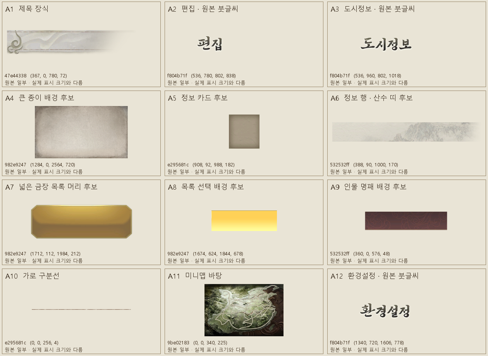

# 인게임 정보 화면 재현을 위한 추가 리소스 분석 — 2026-11-01

## 확인한 결과

참고 화면 `스크린샷 2026-11-01 132652.png`의 제목 장식과 한국어 붓글씨 제목을 포함해 추가 원본을 찾았다. 제목은 일반 UI 글꼴을 크게 그린 것만으로 재현할 필요가 없다. 원본 이미지에 `도시정보`, `무장정보`, `편집`, `환경설정` 캡션이 들어 있다.

제공된 Sam8RE PNG 195장과 SAN8R_UI part01~05의 PNG·texinfo를 시트 단위로 살펴보고 관련 이미지를 선택했다. 아래 추가 G1T 이미지 19장은 설치 게임의 RDB/RDX에서 조회해 FDATA를 해제하고 디코딩한 RGBA가 제공 PNG와 모두 일치했다. 한국어 캡션 texinfo `0x646f670c`도 게임 원본과 ZIP의 바이트가 일치했다.

- [추가 원본 20건의 위치·형식·해시 CSV](UI_InGame_Additional_Resources_2026-11-01.csv): G1T 이미지 19장과 한국어 캡션 texinfo 1개.
- [기존 사용 리소스 대응표](UI_Resource_Map_2026-11-01.md).
- 스크린샷과의 용도 대응은 장식·문구·배치의 시각 대조다. 게임 내부의 UI 배치 데이터나 draw call을 읽어 원본 화면의 조합을 확정한 것은 아니다.

미리보기는 원본 영역을 크기에 맞춰 나열한 분석 자료다. 완성 UI의 배치나 실제 표시 크기를 나타내지 않는다. A4~A9의 용도는 적용 후보로 구분했다.

## 참고 화면과 현재 창의 구조 차이

현재 `feature_menu.cpp::draw_feature_menu`는 종이 패널 안에 작은 제목·설명·탭·단일 본문 child를 넣는다. 창 폭을 늘리는 것과 별개로, 참고 화면의 다음 계층을 반영해야 한다.

| 요소 | 참고 화면에서 보이는 형태 | 현재 구조에서 필요한 변경 |
|---|---|---|
| 화면 제목 | 좌측 상단, 종이 본문 밖의 두루마리 장식과 붓글씨 | 제목을 본문 패널 밖으로 분리하고 장식·캡션을 별도로 그린다. |
| 종이 본문 | 화면 대부분을 차지하는 넓은 종이 면, 가장자리는 부드럽게 어두워짐 | 작은 테두리 창보다 큰 종이 면을 먼저 잡고 내부 영역을 나눈다. |
| 탭 | 본문 위쪽 경계와 붙은 금장 탭 | 본문 시작선과 탭 밑변을 맞춘다. 현재 탭 원본은 재사용 가능하다. |
| 왼쪽 목록 | 넓은 금장 머리, 같은 높이의 행, 노란 선택 배경, 얇은 구분선 | 목록 머리·행 배경·선택·구분선을 분리한다. |
| 중앙 대상 영역 | 인물 이미지, 자주색 명패, 간단한 대상 정보 | 실제 인물 이미지 공급 경로가 별도로 필요하다. 명패 원본은 후보를 확보했다. |
| 오른쪽 정보 | 여러 개의 종이 카드와 이름/값 행, 가는 선, 게이지 | 하나의 큰 박스 대신 기능별 카드와 행으로 나눈다. |
| 뒤로 | 종이 밖 하단 중앙의 붉은 팔각형 | 현재 `return_controls` 원본을 사용하되 본문과 분리한다. |
| 배경 장면 | 종이 주변에서 게임 장면이 흐려지고 어두워짐 | 텍스처 한 장의 효과가 아니다. 장면 흐림과 어두운 덮개는 별도 렌더링 처리 대상이다. |

참고 PNG는 2563×1486이며 상단 창 표시줄은 y=0..44다. 화면 대조에서 사용할 대략적인 클라이언트 비율은 다음과 같다. 게임의 UI 배치 파일에서 읽은 수치는 아니다.

| 영역 | 클라이언트 가로 범위 | 클라이언트 세로 범위 |
|---|---|---|
| 제목 | 왼쪽 끝부터 약 31% | 상단 약 0~9% |
| 큰 종이 본문 | 약 6~94% | 약 12~86% |
| 왼쪽 목록 | 약 13~26% | 약 20~81% |
| 중앙 대상 표시 | 약 28~48% | 약 22~83% |
| 오른쪽 카드 | 약 49~90% | 약 22~83% |
| 뒤로 버튼 | 중심 x 약 50% | 중심 y 약 93% |

즉, 창의 가로·세로 점유율뿐 아니라 제목·종이·하단 버튼의 여백과 본문 안의 열 구성이 재현 대상이다.

## 제목 장식과 한국어 붓글씨

### 제목 바탕: A1

- 게임 리소스: **`0x47e44338`, G1T 이미지 1**, 1024×256 BC3.
- 제공 파일: `SAN8R_UI_part03.zip/UIGlobalTexture1K/png/47e44338_01.png`.
- 장식 영역: **`[367, 0, 780, 72)`**.
- texinfo의 `000_prt_caption_base`에 같은 영역이 기록돼 있다. `texture_index=1`, UV는 `(0.3583984, 0)`~`(0.7617188, 0.28125)`다.
- 공통 texinfo 묶음 `26ddf66d`·`9385d8e4`·`d710f6a5`에서 이 이름·UV를 확인했다. texinfo에 G1T 리소스 ID가 직접 포함된 것은 아니며 이름·UV와 실제 이미지 영역을 대조했다.

같은 이미지의 `000_base_header`는 `[0, 100, 853, 164)`의 긴 종이 띠다. 두 영역의 용도를 구분한다. 제목 바탕 전체를 임의의 종횡비로 늘리기보다 왼쪽 말림 장식과 오른쪽 길이를 나누어 처리하면 장식이 찌그러지는 것을 피할 수 있다.

### 한국어 캡션: A2·A3·A12

- 게임 리소스: **`0xf804b71f`, G1T 이미지 0**, 2048×2048 BC3.
- 제공 파일: `SAN8R_UI_part05.zip/UIGlobalTexture1K/png/f804b71f_00.png`.
- 한국어 texinfo: **`0x646f670c`**, 타입 `0xf20de437`. 레코드 번호는 0부터 시작한다.

| 문구 | texinfo 레코드 | 원본 sprite 이름 | 픽셀 영역 |
|---|---:|---|---|
| 환경설정 | 83 | `000_txt_caption_120_00_02_00` | `[1340,720,1606,778)` |
| 편집 | 87 | `000_txt_caption_120_00_04_02` | `[536,780,802,838)` |
| 도시정보 | 109 | `000_txt_caption_120_30_03_00` | `[536,960,802,1018)` |
| 무장정보 | 111 | `000_txt_caption_120_40_01_00` | `[1072,960,1338,1018)` |

스크린샷 같은 화면 제목에는 이 캡션 이미지를 쓰고, 숫자·무장 이름·편집 가능한 문구에는 원본 G1N 글꼴을 사용하면 역할이 맞는다. G1N 폰트 직접 로딩만으로 위 붓글씨 캡션과 같은 외형이 된다고 볼 수는 없다.

`편집 도구`라는 완성 문구는 이 시트에서 확인하지 못했다. 상위 화면명을 원본 `편집`으로 표현할 수 있고, 다른 문구가 필요하면 동적 글꼴 표시와 구분해서 설계해야 한다. 기존 캡션의 글자를 잘라 새로운 문구로 조합한 리소스는 만들지 않았다.

## 본문·목록·카드 추가 후보

모든 영역은 원본 이미지의 `[left,top,right,bottom)` 좌표다. 아래 A4~A9는 해당 화면에서 실제 선택되는 sprite ID를 확정한 것이 아니라 원본에서 확인한 재사용 후보다.

| 미리보기 | 역할 | 리소스 / 이미지 | 원본 영역 | 적용 시 고려 사항 |
|---|---|---|---|---|
| A4 | 큰 종이 면 | `0x982e9247` / 2 | `[1284,0,2564,720)` | 4096×2048 시트의 종이 부분. 가장자리 명암을 포함한다. 현재 종이 배경과 비교할 후보. |
| A5 | 작은 종이 카드 | `0xe295681c` / 6 | `[908,92,988,182)` | 모서리·음영을 가진 작은 카드. Nine-slice로 정보 묶음 바탕을 구성할 후보. |
| A6 | 정보 행 배경 | `0x532532ff` / 1 | `[388,90,1000,170)` | 종이와 산수 장식이 함께 있다. 높이를 크게 늘리면 그림이 왜곡되므로 행·띠 용도로 구분. |
| A7 | 넓은 금장 목록 머리 | `0x982e9247` / 1 | `[1712,112,1984,212)` | 참고의 ‘도시’ 머리와 같은 넓은 금장 형태를 만들 후보. 모서리 폭을 보존. |
| A8 | 노란 선택 배경 | `0x982e9247` / 1 | `[1674,624,1844,678)` | 목록 행의 선택을 표현할 후보. 글씨·행 구분선과 별도 레이어. |
| A9 | 자주색 명패 | `0x532532ff` / 1 | `[360,0,576,48)` | 인물·대상 이름 밑의 문양 바탕. 국가 표식과 이름은 별도로 겹친다. |
| A10 | 가로 구분선 | `0xe295681c` / 61 | `[0,0,256,4)` | 행 길이에 맞춰 늘리고 화면에서 가늘게 표시. |
| — | 세로 구분선 | `0xe295681c` / 62 | `[0,0,4,256)` | 정보 카드의 두 열을 나눌 때 사용할 후보. |
| A11 | 미니맵 바탕 | `0x9be02183` / 0 | `[0,0,340,225)` | 도로가 그려진 지도 바탕. 도시 위치·색·선택 표시는 이 이미지에 포함되지 않음. |

큰 종이 바탕, 정보 카드, 인물 명패를 같은 아틀라스의 한 영역으로 처리할 필요는 없다. 현재 `UiAtlasTextures`의 고정 5개 슬롯은 위 추가 이미지를 모두 표현하지 못하므로, 실제 적용 단계에서 필요한 용도별 텍스처 공급을 정해야 한다. 이번 분석에서는 슬롯이나 런타임 코드를 변경하지 않았다.

### 함께 확인한 대안

CSV에는 `e295681c` 이미지 7·21·25·26·38·40·52도 포함했다. 이미지 7은 작은 종이 질감, 21은 가장자리가 남고 중앙이 비는 종이 프레임, 25·26은 여러 버튼·상태 영역, 38·40·52는 선·장식이다. 본문 중심을 채우는 질감과 바깥쪽 프레임을 구분해서 사용할 수 있다.

`982e9247` 이미지 3과 `532532ff` 이미지 2도 작은 종이 질감이다. `772355dc` 이미지 0에는 지도와 지역 조각이 들어 있지만 인물 초상화는 없다. 이 이미지들을 새 UI의 필수 로딩 목록으로 확정하지는 않았다.

## 원본 조회 위치

추가 후보의 물리 위치는 CSV에 기록했다. 제목 관련 리소스는 기존 버튼 묶음과 **다른 FDATA**에 있다.

| 리소스 | 현재 설치본 FDATA | 레코드 위치 | 해제된 크기 |
|---|---|---:|---:|
| 제목 장식 `47e44338` | `0xc5a89602.fdata` | 2,139,056 | 1,310,804 |
| 한국어 제목 `f804b71f` | `0xc5a89602.fdata` | 365,488 | 4,194,360 |
| 한국어 캡션 texinfo `646f670c` | `0xc5a89602.fdata` | 2,135,072 | 12,900 |
| 정보 행·명패 `532532ff` | `0x6cfd30bf.fdata` | 11,594,320 | 1,065,072 |
| 목록·종이 `982e9247` | `0x6cfd30bf.fdata` | 20,123,296 | 10,829,992 |
| 미니맵 `9be02183` | `0x6cfd30bf.fdata` | 46,106,528 | 131,128 |

이 위치를 고정값으로 구현하지 않고 시작 시 리소스 ID로 조회한다.

## 별도로 확인해야 하는 요소

- **인물 이미지**: 이번 UI PNG 묶음에서는 손상향 인물 이미지의 리소스 ID를 확인하지 못했다. 선택 무장에 맞는 이미지 공급 경로가 별도로 필요하다.
- **국가·세력 표식**: 참고 화면의 녹색 국가 표식과 대응하는 개별 sprite는 미확인이다.
- **미니맵의 도시점**: 지도 바탕은 확인했지만 도시 좌표·세력 색·현재 위치를 동기화할 데이터 경로는 별도로 필요하다.
- **게임 장면 흐림**: PNG의 투명 가장자리와 게임 장면 자체의 흐림은 다르다. 후자는 별도 렌더링 처리 대상이다.
- **화면별 배치 정의**: texinfo의 sprite 이름·UV는 확인했지만 도시정보 화면의 레이아웃 파일과 실제 그리기 순서는 이번 분석에 포함하지 않았다.

## 적용 우선순위

1. 제목을 본문 밖으로 분리하고 A1에 원본 `편집` 캡션을 겹친다.
2. 큰 종이 면 안에서 왼쪽 카테고리 목록과 오른쪽 편집 카드를 나눈다. 현재 카테고리 전환·명령 처리를 연결한다.
3. A7·A8과 얇은 선으로 목록 머리·선택 행을 구성하고 카드 배경·글자 크기·행 높이를 맞춘다.
4. 현재 붉은 팔각형 뒤로 버튼을 종이 밖 하단 중앙에 둔다.
5. 인물 이미지·세력 표식·도시점·배경 흐림은 각각의 공급 경로를 확인한 뒤 추가한다.

이번 변경은 분석 문서·CSV·후보 이미지뿐이다. 빌드·자동 테스트·게임 실행은 하지 않았다.
